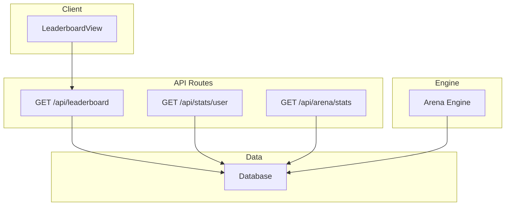
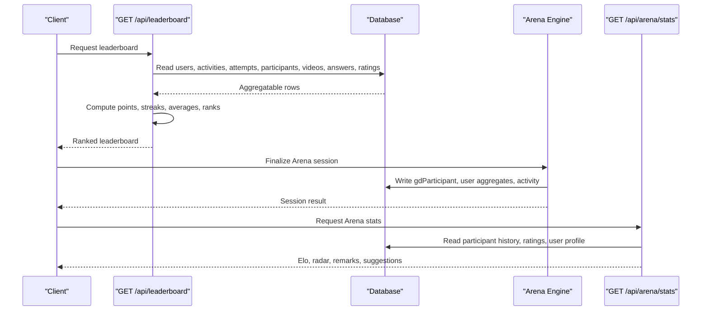
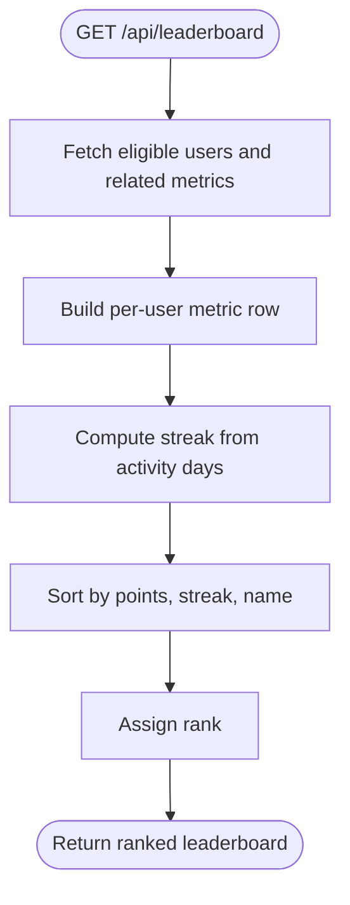
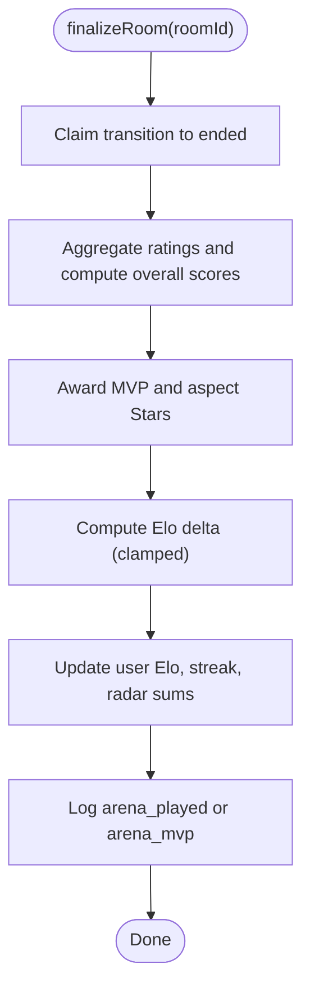
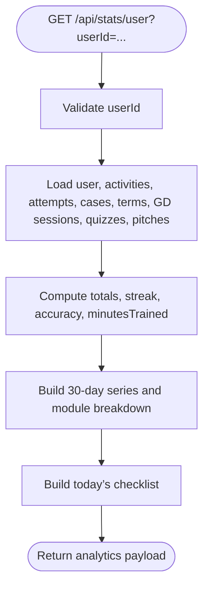
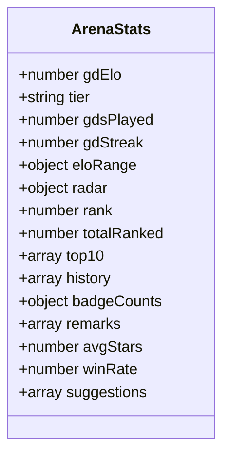
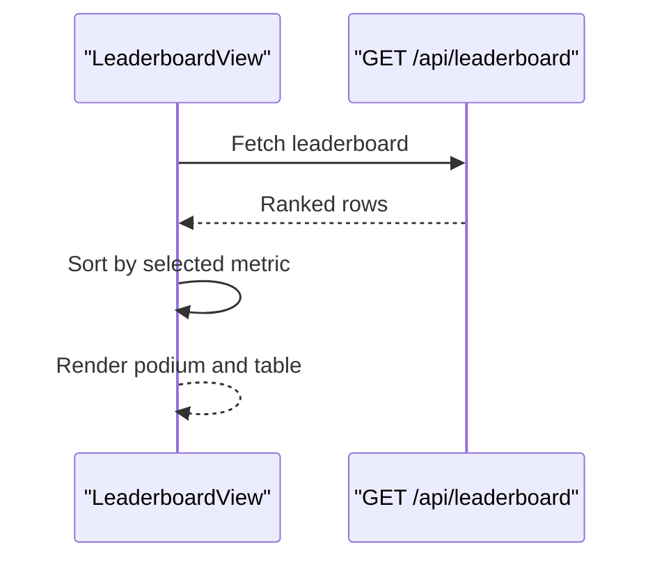
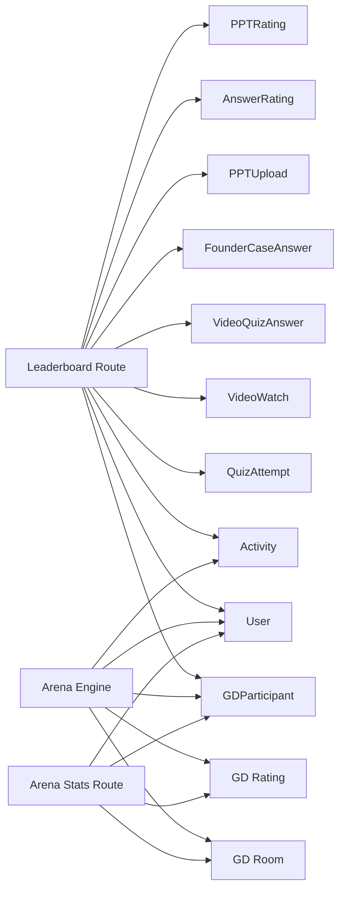

# Gamification & Analytics

<cite>
**Referenced Files in This Document**
- [leaderboard route](file://src/app/api/leaderboard/route.ts)
- [leaderboard view](file://src/components/welearn/leaderboard-view.tsx)
- [user stats route](file://src/app/api/stats/user/route.ts)
- [arena engine](file://src/lib/arena-engine.ts)
- [arena stats route](file://src/app/api/arena/stats/route.ts)
</cite>

## Table of Contents
1. [Introduction](#introduction)
2. [Project Structure](#project-structure)
3. [Core Components](#core-components)
4. [Architecture Overview](#architecture-overview)
5. [Detailed Component Analysis](#detailed-component-analysis)
6. [Dependency Analysis](#dependency-analysis)
7. [Performance Considerations](#performance-considerations)
8. [Troubleshooting Guide](#troubleshooting-guide)
9. [Conclusion](#conclusion)

## Introduction
This document explains the gamification and analytics system that powers multi-metric leaderboards, Arena Elo ratings, achievement badges, activity logging, user progress tracking, personal analytics, peer remarks, and privacy-aware reporting. It focuses on how data flows from learning activities into aggregated metrics, how rankings are computed, and how users see their performance through dashboards and profile views.

## Project Structure
The gamification and analytics features are implemented as:
- Server API routes for leaderboard aggregation, personal analytics, and Arena statistics.
- A client-side leaderboard dashboard.
- An Arena engine that computes Elo, badges, streaks, and coaching suggestions.

**Diagram sources**
- [leaderboard view:50-59](file://src/components/welearn/leaderboard-view.tsx#L50-L59)
- [leaderboard route:5-66](file://src/app/api/leaderboard/route.ts#L5-L66)
- [user stats route:5-97](file://src/app/api/stats/user/route.ts#L5-L97)
- [arena stats route:6-93](file://src/app/api/arena/stats/route.ts#L6-L93)
- [arena engine:209-365](file://src/lib/arena-engine.ts#L209-L365)

**Section sources**
- [leaderboard route:5-66](file://src/app/api/leaderboard/route.ts#L5-L66)
- [leaderboard view:50-188](file://src/components/welearn/leaderboard-view.tsx#L50-L188)
- [user stats route:5-97](file://src/app/api/stats/user/route.ts#L5-L97)
- [arena engine:209-365](file://src/lib/arena-engine.ts#L209-L365)
- [arena stats route:6-93](file://src/app/api/arena/stats/route.ts#L6-L93)

## Core Components
- Multi-metric leaderboard: aggregates points, puzzle completion, quiz performance, video engagement, Arena star averages, answers/decks quality, ratings given, activity volume, and streaks.
- Arena Elo and badges: per-session scoring, Elo deltas, MVP and aspect stars, streak updates, and coaching suggestions.
- Personal analytics: YouTube-Studio-style daily series, module breakdown, today’s checklist, totals, and recent history.
- Peer remarks: feedback collected during Arena sessions surfaced on profiles.

**Section sources**
- [leaderboard route:5-66](file://src/app/api/leaderboard/route.ts#L5-L66)
- [arena engine:209-365](file://src/lib/arena-engine.ts#L209-L365)
- [user stats route:5-97](file://src/app/api/stats/user/route.ts#L5-L97)
- [arena stats route:34-93](file://src/app/api/arena/stats/route.ts#L34-L93)

## Architecture Overview
The system combines event-driven activity logging with batched aggregation at request time. Leaderboard and analytics endpoints read from multiple tables, compute derived metrics, and return structured JSON to clients. The Arena engine writes session outcomes (Elo, badges, streaks, activity) and exposes a profile endpoint for detailed stats.

**Diagram sources**
- [leaderboard route:5-66](file://src/app/api/leaderboard/route.ts#L5-L66)
- [arena engine:209-365](file://src/lib/arena-engine.ts#L209-L365)
- [arena stats route:6-93](file://src/app/api/arena/stats/route.ts#L6-L93)

## Detailed Component Analysis

### Multi-Metric Leaderboard
The leaderboard endpoint computes a comprehensive ranking across several dimensions:
- Points: sum of activity points.
- Puzzles solved: count of puzzle_solved actions.
- Quiz performance: number of correct quiz attempts.
- Arena participation: number of sessions and average overall star rating; includes ELO.
- Video engagement: watched count and correct video quiz answers.
- Founder-case answers and uploaded decks: counts and average peer star ratings.
- Ratings given: total peer ratings provided by the user.
- Activity volume and last active timestamp.
- Streak: consecutive IST days with any activity.

Ranking algorithm:
- Primary sort by points descending.
- Secondary sort by streak descending.
- Tertiary alphabetical tie-breaker by name.
- Rank is assigned sequentially after sorting.

**Diagram sources**
- [leaderboard route:5-66](file://src/app/api/leaderboard/route.ts#L5-L66)

**Section sources**
- [leaderboard route:5-66](file://src/app/api/leaderboard/route.ts#L5-L66)
- [leaderboard view:50-188](file://src/components/welearn/leaderboard-view.tsx#L50-L188)

### Arena Elo, Badges, and Coaching
The Arena engine finalizes sessions by:
- Aggregating peer star ratings per mode-specific aspects.
- Computing an overall score per participant.
- Awarding badges: MVP and one Star per aspect where applicable.
- Calculating Elo delta based on overall score, MVP bonus, and host bonus, clamped within bounds.
- Updating user Elo, play count, streak, and canonical radar axes.
- Logging an activity entry with points and details.

**Diagram sources**
- [arena engine:209-365](file://src/lib/arena-engine.ts#L209-L365)

Key behaviors:
- Elo range and tier labels are defined centrally.
- Radar axes map mode-specific aspects to canonical dimensions.
- Coaching suggestions are generated from played count, radar values, and win rate.

**Section sources**
- [arena engine:55-66](file://src/lib/arena-engine.ts#L55-L66)
- [arena engine:70-86](file://src/lib/arena-engine.ts#L70-L86)
- [arena engine:209-365](file://src/lib/arena-engine.ts#L209-L365)
- [arena engine:375-414](file://src/lib/arena-engine.ts#L375-L414)

### Personal Analytics Dashboard
The personal analytics endpoint provides a YouTube-Studio-style overview:
- Totals: points, streak, puzzles attempted/solved, accuracy, minutes trained, cases analyzed, decks ready, terms known, GD sessions, active days, quiz questions attempted/solved/accuracy, pitches completed.
- Daily series: last 30 days of points and activity counts.
- Module breakdown: points and counts per module.
- Today’s checklist: whether the user engaged with each module today.
- Recent activity and attempt history.

**Diagram sources**
- [user stats route:5-97](file://src/app/api/stats/user/route.ts#L5-L97)

**Section sources**
- [user stats route:5-97](file://src/app/api/stats/user/route.ts#L5-L97)

### Arena Profile and Peer Remarks
The Arena stats endpoint returns:
- Elo, tier, play count, streak, and global rank among rated users.
- Radar chart data (content, delivery, listening, leadership).
- History of finalized sessions with stance, avg stars, Elo deltas, and badges.
- Badge counts across all sessions.
- Peer remarks received by the user, including room context and timestamps.
- Win rate, average stars, and coaching suggestions.

**Diagram sources**
- [arena stats route:6-93](file://src/app/api/arena/stats/route.ts#L6-L93)

**Section sources**
- [arena stats route:6-93](file://src/app/api/arena/stats/route.ts#L6-L93)

### Leaderboard UI
The leaderboard view:
- Fetches the leaderboard via API.
- Supports sorting by different metrics (points, Arena stars, quiz solved, answer stars, deck stars).
- Renders a podium for top three and a table for the rest.
- Highlights the current user and shows last-active relative time.

**Diagram sources**
- [leaderboard view:50-188](file://src/components/welearn/leaderboard-view.tsx#L50-L188)
- [leaderboard route:5-66](file://src/app/api/leaderboard/route.ts#L5-L66)

**Section sources**
- [leaderboard view:50-188](file://src/components/welearn/leaderboard-view.tsx#L50-L188)

## Dependency Analysis
- Leaderboard depends on:
  - User table (role filtering).
  - Activity table (points, action, createdAt).
  - QuizAttempt table (correctness).
  - GD participant table (avgOverall).
  - VideoWatch and videoQuizAnswer tables (engagement and correctness).
  - FounderCaseAnswer and PPTUpload tables (peer-star aggregations).
  - AnswerRating and PPTRating tables (ratings given).
- Arena engine depends on:
  - GD room/participant/rating tables.
  - User table (Elo, streaks, radar sums).
  - Activity table (logging).
  - AI helper for MoM narrative generation.
- Arena stats depends on:
  - GD participant and room tables.
  - GD rating table (remarks).
  - User table (profile and aggregates).
  - Arena engine helpers (tier, suggestions).

**Diagram sources**
- [leaderboard route:10-27](file://src/app/api/leaderboard/route.ts#L10-L27)
- [arena engine:209-365](file://src/lib/arena-engine.ts#L209-L365)
- [arena stats route:15-43](file://src/app/api/arena/stats/route.ts#L15-L43)

**Section sources**
- [leaderboard route:10-27](file://src/app/api/leaderboard/route.ts#L10-L27)
- [arena engine:209-365](file://src/lib/arena-engine.ts#L209-L365)
- [arena stats route:15-43](file://src/app/api/arena/stats/route.ts#L15-L43)

## Performance Considerations
- Parallel reads: The leaderboard endpoint uses parallel database queries to reduce latency when assembling metrics.
- In-memory aggregation: Metrics are computed in memory after fetching minimal necessary fields, reducing payload size.
- Sorting and ranking: Sorting occurs client-side for interactive tabs, while server-side ranking ensures consistent ordering.
- Arena finalization: Uses atomic transitions to avoid race conditions and idempotent updates.
- Recommendations:
  - Add indexes on frequently filtered columns such as userId, createdAt, and role.
  - Paginate large datasets (e.g., history arrays) if they grow significantly.
  - Cache static configuration like Elo bounds and tiers.
  - Consider precomputing daily series for analytics if query load increases.

[No sources needed since this section provides general guidance]

## Troubleshooting Guide
Common issues and resolutions:
- Leaderboard not loading:
  - Check network errors and toast messages in the leaderboard view.
  - Verify that the leaderboard endpoint returns valid JSON and does not throw internal errors.
- Incorrect streaks:
  - Ensure activity timestamps are correctly converted to IST day keys before computing streaks.
- Missing Arena stats:
  - Confirm userId parameter is present and valid.
  - Verify that the user has participated in at least one finalized session to populate radar and history.
- Peer remarks not visible:
  - Ensure remarks exist in GD ratings and are not null.
  - Check that the remarks endpoint returns up to 30 entries ordered by recency.

**Section sources**
- [leaderboard view:55-59](file://src/components/welearn/leaderboard-view.tsx#L55-L59)
- [leaderboard route:67-69](file://src/app/api/leaderboard/route.ts#L67-L69)
- [arena stats route:8-13](file://src/app/api/arena/stats/route.ts#L8-L13)
- [arena stats route:34-43](file://src/app/api/arena/stats/route.ts#L34-L43)

## Conclusion
The gamification and analytics system integrates activity logging, peer feedback, and multi-dimensional scoring to provide meaningful leaderboards, personalized analytics, and actionable coaching. The Arena engine centralizes Elo calculations, badge awards, and streak management, while dedicated endpoints expose rich data for both public leaderboards and private user profiles. With careful indexing, caching, and pagination strategies, the system can scale to support growing cohorts and richer analytics.

[No sources needed since this section summarizes without analyzing specific files]