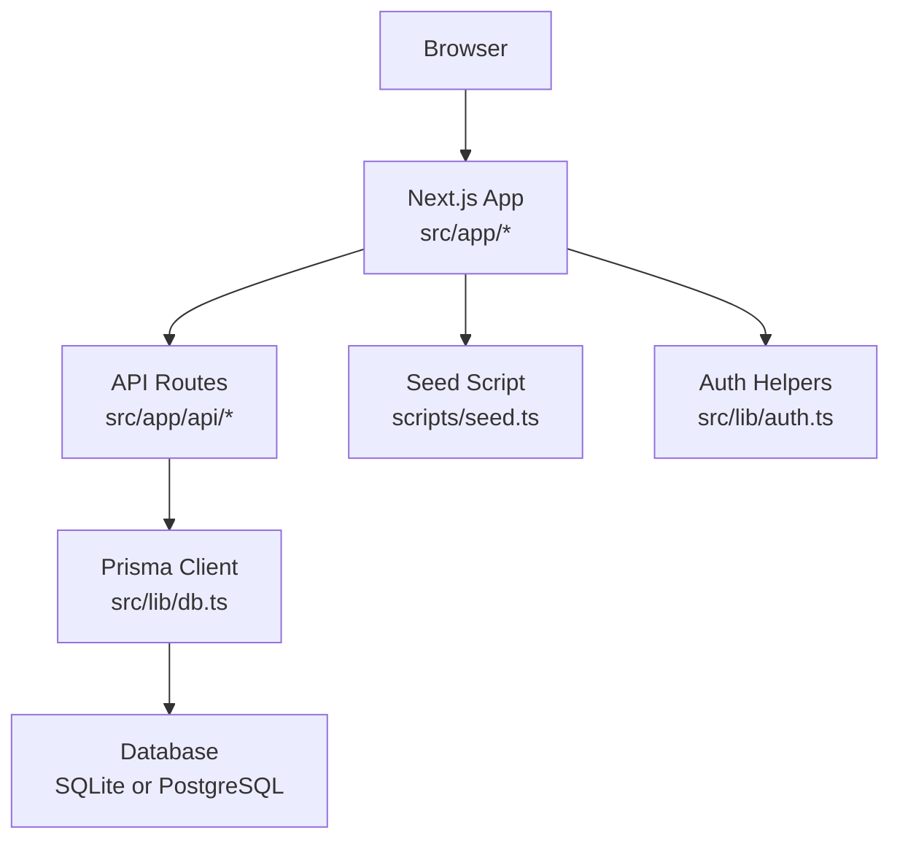
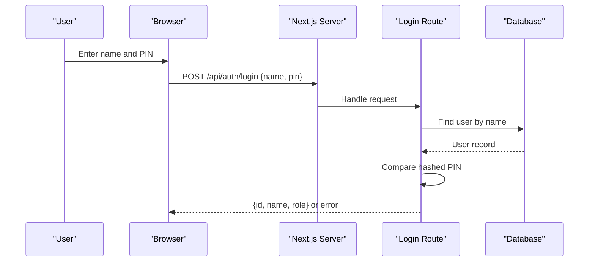
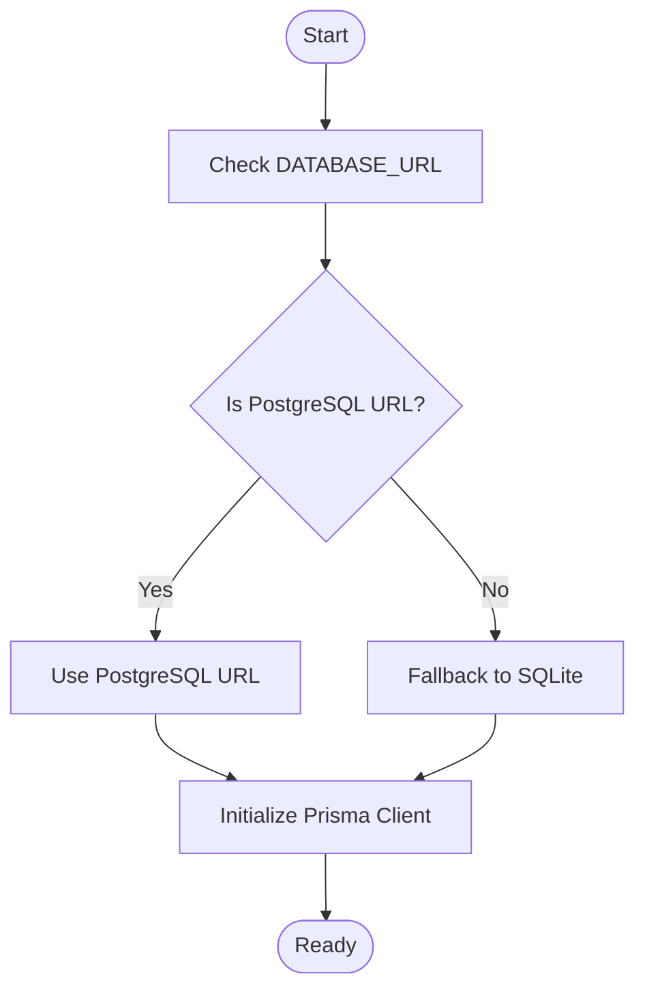
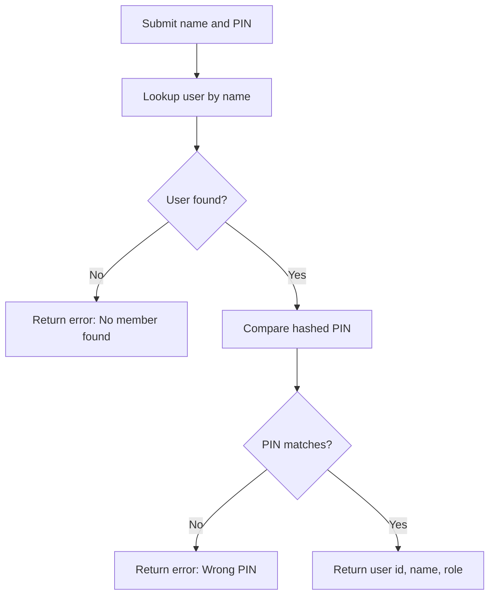
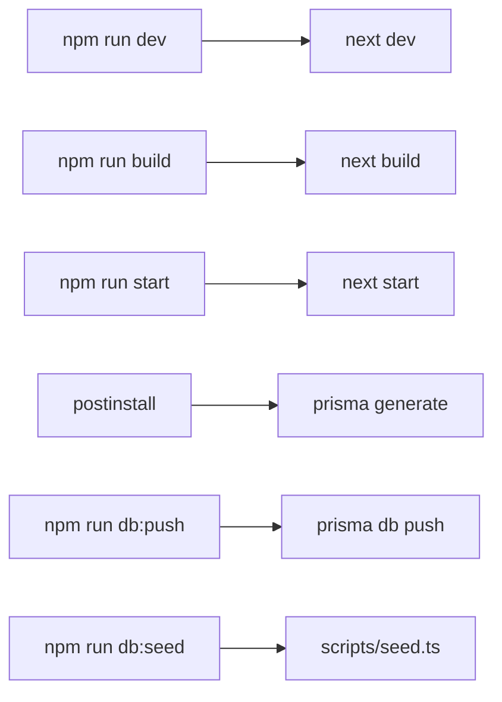

# Getting Started

<cite>
**Referenced Files in This Document**
- [README.md](file://README.md)
- [package.json](file://package.json)
- [schema.prisma](file://prisma/schema.prisma)
- [seed.ts](file://scripts/seed.ts)
- [db.ts](file://src/lib/db.ts)
- [auth.ts](file://src/lib/auth.ts)
- [login route.ts](file://src/app/api/auth/login/route.ts)
- [init_postgresql.sql](file://supabase/migrations/20261107_init_postgresql.sql)
</cite>

## Table of Contents
1. [Introduction](#introduction)
2. [Project Structure](#project-structure)
3. [Core Components](#core-components)
4. [Architecture Overview](#architecture-overview)
5. [Detailed Component Analysis](#detailed-component-analysis)
6. [Dependency Analysis](#dependency-analysis)
7. [Performance Considerations](#performance-considerations)
8. [Troubleshooting Guide](#troubleshooting-guide)
9. [Conclusion](#conclusion)

## Introduction
WeLearn is an E-Cell preparation platform that combines timed puzzles, startup case teardowns, a shared video zone with peer quizzes, live arena battle rooms (group discussion, debate, pitching), founder-mode quizzes, pitch-deck challenges, a multi-metric leaderboard, and personal analytics. It uses Next.js, TypeScript, Tailwind, shadcn/ui, Prisma, SQLite or Supabase PostgreSQL, and optional Groq AI for content generation.

This guide walks you through:
- Installing dependencies with npm or Bun
- Initializing the database with Prisma
- Configuring environment variables
- Seeding starter data
- Running the local development server
- Logging in as admin and configuring team PIN
- Enabling Groq AI
- Moving to Supabase and deploying

## Project Structure
At a high level:
- `src/app` contains Next.js pages and API routes
- `src/lib` holds shared logic (database client, authentication helpers, seed data)
- `prisma/schema.prisma` defines the data model used by Prisma
- `scripts/seed.ts` seeds users, puzzles, cases, quiz tracks/questions/badges, videos, founder cases, and PPT challenges
- `supabase/migrations` contains PostgreSQL schema alignment scripts for Supabase
- `public/uploads/ppts` is where presentation uploads are stored locally

**Diagram sources**
- [package.json:5-14](file://package.json#L5-L14)
- [schema.prisma:5-9](file://prisma/schema.prisma#L5-L9)
- [seed.ts:1-13](file://scripts/seed.ts#L1-L13)
- [db.ts:1-49](file://src/lib/db.ts#L1-L49)
- [auth.ts:1-25](file://src/lib/auth.ts#L1-L25)

**Section sources**
- [README.md:1-10](file://README.md#L1-L10)
- [package.json:1-15](file://package.json#L1-L15)

## Core Components
- Application runtime: Next.js with TypeScript and Tailwind
- Data layer: Prisma ORM over SQLite (local) or PostgreSQL (Supabase)
- Authentication: Name + PIN login; admin role support; team PIN for shared actions
- Content seeding: Puzzles, case studies, terms, quiz tracks/questions/badges, videos, founder cases, PPT challenges
- Optional AI: Groq integration for content generation features

Key responsibilities:
- `package.json`: Scripts for dev, build, start, lint, Prisma generate, push, migrate, and seed
- `prisma/schema.prisma`: Defines all models (User, Puzzle, CaseStudy, QuizTrack, GdRoom, etc.)
- `scripts/seed.ts`: Creates the default admin user and populates initial content
- `src/lib/db.ts`: Resolves database URL across environments and exports a Prisma client
- `src/lib/auth.ts`: PIN hashing, validation, and team PIN enforcement
- `src/app/api/auth/login/route.ts`: Validates name/PIN and returns user identity

**Section sources**
- [package.json:5-14](file://package.json#L5-L14)
- [schema.prisma:11-48](file://prisma/schema.prisma#L11-L48)
- [seed.ts:15-25](file://scripts/seed.ts#L15-L25)
- [db.ts:7-49](file://src/lib/db.ts#L7-L49)
- [auth.ts:3-25](file://src/lib/auth.ts#L3-L25)
- [login route.ts:6-20](file://src/app/api/auth/login/route.ts#L6-L20)

## Architecture Overview
The app follows a standard Next.js API-driven architecture:
- Frontend calls API routes under `src/app/api`
- API routes use Prisma to read/write data
- Database provider is configured via Prisma and environment variables
- Admin and team PIN logic is enforced server-side

**Diagram sources**
- [login route.ts:6-20](file://src/app/api/auth/login/route.ts#L6-L20)
- [auth.ts:9-10](file://src/lib/auth.ts#L9-L10)

## Detailed Component Analysis

### Installation and Environment Setup
Follow these steps to set up WeLearn locally:

1. Install dependencies
   - Using npm: `npm install`
   - Using Bun: `bun install`

2. Initialize the database
   - Push schema to create tables: `npx prisma db push`

3. Seed starter data
   - Run the seed script: `node scripts/seed.ts` or `bun scripts/seed.ts`

4. Start the development server
   - Command: `npm run dev`
   - Access the app at: `http://localhost:3000`

Environment variables:
- `DATABASE_URL`: Required for both SQLite and PostgreSQL. For local SQLite, Prisma will use the default SQLite file when no PostgreSQL URL is provided. For Supabase, set a PostgreSQL connection string.
- `GROQ_API_KEY`: Optional. Enables AI generation features. Without it, generation falls back to curated banks.
- `TEAM_PIN`: Optional. Controls the shared team PIN used for adding/removing shared content. Default is `1408`.
- `ADMIN_PIN`: Optional. Used by the seed script to create the admin account. Default is `1234`.

Verification checklist:
- Dependencies installed without errors
- Database tables created successfully
- Seed script completes and prints counts for puzzles, cases, terms, quiz tracks/questions/badges, videos, founder cases, and PPT challenges
- Development server starts and serves the app at `http://localhost:3000`

**Section sources**
- [README.md:11-22](file://README.md#L11-L22)
- [package.json:5-14](file://package.json#L5-L14)
- [seed.ts:15-25](file://scripts/seed.ts#L15-L25)
- [db.ts:7-32](file://src/lib/db.ts#L7-L32)
- [auth.ts:5-7](file://src/lib/auth.ts#L5-L7)

### Database Initialization with Prisma
Prisma manages your schema and migrations:
- Schema definition lives in `prisma/schema.prisma`
- Use `npx prisma db push` to apply schema changes to your database
- Use `npm run db:seed` or `bun scripts/seed.ts` to populate starter data

Local development uses SQLite by default unless a PostgreSQL URL is detected. The database client resolves several environment variable names for PostgreSQL compatibility.

**Diagram sources**
- [db.ts:7-49](file://src/lib/db.ts#L7-L49)

**Section sources**
- [schema.prisma:5-9](file://prisma/schema.prisma#L5-L9)
- [db.ts:7-49](file://src/lib/db.ts#L7-L49)

### Environment Configuration (.env)
Create a `.env` file in the project root with the following variables as needed:

- `DATABASE_URL`: Connection string for your database
  - Local SQLite: leave unset or provide SQLite URL if required by your setup
  - Supabase PostgreSQL: provide a PostgreSQL connection string
- `GROQ_API_KEY`: Your Groq API key for AI generation
- `TEAM_PIN`: Shared team PIN for protected actions (default `1408`)
- `ADMIN_PIN`: Admin PIN used during seeding (default `1234`)

Notes:
- If `DATABASE_URL` is not set or does not point to PostgreSQL, the app falls back to SQLite for local development.
- Team PIN is validated server-side for shared content operations.
- Admin PIN is hashed before storage using a salted SHA-256 hash.

**Section sources**
- [README.md:24-32](file://README.md#L24-L32)
- [auth.ts:3-7](file://src/lib/auth.ts#L3-L7)
- [seed.ts:18-24](file://scripts/seed.ts#L18-L24)

### Seeding Data
The seed script creates:
- Admin user with name `E-Cell Admin` and role `admin`
- Puzzles, case studies, and terms
- Founder quiz tracks, questions, and badges
- Video Zone entries synced from case studies
- Founder case prompts and PPT challenges

Run the seed script after initializing the database:
- `node scripts/seed.ts`
- `bun scripts/seed.ts`

Expected output includes confirmation lines for each seeded entity type.

**Section sources**
- [seed.ts:15-25](file://scripts/seed.ts#L15-L25)
- [seed.ts:27-83](file://scripts/seed.ts#L27-L83)
- [seed.ts:92-195](file://scripts/seed.ts#L92-L195)
- [seed.ts:197-240](file://scripts/seed.ts#L197-L240)

### Admin Login Process and Team PIN
Admin login:
- Name: `E-Cell Admin`
- PIN: `1234` (or whatever `ADMIN_PIN` was used during seeding)
- After logging in, change the PIN via the UI (My Studio → Change PIN)

Team PIN:
- Default: `1408`
- Used for two-step confirmation when adding/removing shared content (videos, questions, challenges, room deletions by non-hosts)
- Configure via `TEAM_PIN` in `.env`

Authentication flow:
- The login endpoint validates the name against stored users
- It compares the provided PIN with the stored hashed PIN
- On success, it returns user identity and role

**Diagram sources**
- [login route.ts:6-20](file://src/app/api/auth/login/route.ts#L6-L20)
- [auth.ts:9-10](file://src/lib/auth.ts#L9-L10)

**Section sources**
- [README.md:20-22](file://README.md#L20-L22)
- [auth.ts:5-7](file://src/lib/auth.ts#L5-L7)
- [login route.ts:6-20](file://src/app/api/auth/login/route.ts#L6-L20)

### Groq AI Integration
To enable AI-powered content generation:
1. Obtain a free API key at console.groq.com/keys
2. Add `GROQ_API_KEY` to `.env`
3. Optionally set `GROQ_MODEL` to select a specific model
4. Restart the development server

Without a Groq key, generation features fall back to curated content banks.

**Section sources**
- [README.md:24-32](file://README.md#L24-L32)

### Production Deployment to Supabase
Steps to move the database to Supabase:
1. Create a Supabase project and get the connection string (URI)
2. Set `DATABASE_URL` in `.env` to the PostgreSQL connection string
3. Apply the schema: `npx prisma db push`
4. Seed data if needed: `node scripts/seed.ts`

For Vercel deployment:
- Push the repository to GitHub
- Import into Vercel
- Add environment variables: `DATABASE_URL`, `GROQ_API_KEY`, optional `TEAM_PIN`
- Deploy

Important notes for Vercel + Supabase:
- Append `?pgbouncer=true&connection_limit=1` to `DATABASE_URL`
- Ensure Prisma client is generated post-install (`postinstall` script is present)
- File uploads to `public/uploads/ppts` are not writable on Vercel’s read-only filesystem; consider mounting a blob store (e.g., Supabase Storage or Vercel Blob) or running the server elsewhere

**Section sources**
- [README.md:34-61](file://README.md#L34-L61)
- [package.json:10-14](file://package.json#L10-L14)

### Data Model Overview
The application models users, puzzles, case studies, quiz tracks/questions/badges, arena sessions/participants/ratings, video zone content, founder cases, PPT challenges, word learning progress, crosswords, and memory profiles.

```mermaid
erDiagram
USER ||--o{ PUZZLE_ATTEMPT : "has attempts"
PUZZLE ||--o{ PUZZLE_ATTEMPT : "receives attempts"
USER ||--o{ CASE_PROGRESS : "tracks progress"
CASE_STUDY ||--o{ CASE_PROGRESS : "has progress"
USER ||--o{ TERM_REVIEW : "reviews terms"
TERM ||--o{ TERM_REVIEW : "is reviewed"
QUIZ_TRACK ||--o{ QUIZ_QUESTION : "contains questions"
QUIZ_QUESTION ||--o{ QUIZ_ATTEMPT : "receives attempts"
QUIZ_TRACK ||--o{ QUIZ_BADGE : "awards badges"
USER ||--o{ QUIZ_USER_BADGE : "holds badges"
QUIZ_BADGE ||--o{ QUIZ_USER_BADGE : "assigned to users"
USER ||--o{ GD_SESSION : "participates in sessions"
GD_ROOM ||--o{ GD_PARTICIPANT : "has participants"
GD_PARTICIPANT ||--o{ GD_RATING : "receives ratings"
GD_ROOM ||--o{ GD_RATING : "collects ratings"
USER ||--o{ VIDEO_WATCH : "watches videos"
CASE_VIDEO ||--o{ VIDEO_WATCH : "is watched"
CASE_VIDEO ||--o{ VIDEO_QUIZ_QUESTION : "has questions"
USER ||--o{ VIDEO_QUIZ_ANSWER : "answers questions"
VIDEO_QUIZ_QUESTION ||--o{ VIDEO_QUIZ_ANSWER : "receives answers"
FOUNDER_CASE_QUESTION ||--o{ FOUNDER_CASE_ANSWER : "has answers"
USER ||--o{ FOUNDER_CASE_ANSWER : "submits answers"
ANSWER_RATING ||--o{ FOUNDER_CASE_ANSWER : "rates answers"
PPT_CHALLENGE ||--o{ PPT_UPLOAD : "has uploads"
USER ||--o{ PPT_UPLOAD : "creates uploads"
PPT_UPLOAD ||--o{ PPT_RATING : "receives ratings"
USER ||--o{ PPT_RATING : "rates uploads"
USER ||--o{ WORD_PROGRESS : "tracks words"
WORD ||--o{ WORD_PROGRESS : "tracked by users"
CROSSWORD ||--o{ CROSSWORD_WORD : "contains words"
WORD ||--o{ CROSSWORD_WORD : "used in crosswords"
CROSSWORD ||--o{ CROSSWORD_SOLVE : "has solves"
USER ||--o{ CROSSWORD_SOLVE : "completes crosswords"
MEMORY_PROFILE ||--|| USER : "belongs to user"
```

**Diagram sources**
- [schema.prisma:11-641](file://prisma/schema.prisma#L11-L641)

## Dependency Analysis
Key runtime dependencies:
- Next.js application framework
- Prisma ORM for database access
- React ecosystem for UI components
- Tailwind CSS for styling
- Optional Groq AI integration for content generation

Build and development scripts:
- `dev`: Starts the Next.js development server
- `build`: Builds the production bundle
- `start`: Runs the production server
- `lint`: Lints code
- `postinstall`: Generates Prisma client
- `db:push`: Pushes schema to the database
- `db:migrate-all`: Runs migration helper script
- `db:seed`: Seeds starter data
- `db:seed-words`: Seeds word-related data

**Diagram sources**
- [package.json:5-14](file://package.json#L5-L14)

**Section sources**
- [package.json:5-14](file://package.json#L5-L14)

## Performance Considerations
- Use PostgreSQL (Supabase) for production workloads instead of SQLite for better concurrency and scalability.
- When deploying to Vercel with Supabase, configure connection pooling parameters in `DATABASE_URL` and ensure Prisma client generation runs post-install.
- Avoid unnecessary re-seeding in production; seed once during setup.
- Monitor database query logs via Prisma client configuration for performance tuning.

[No sources needed since this section provides general guidance]

## Troubleshooting Guide
Common issues and resolutions:

- Cannot connect to the database
  - Verify `DATABASE_URL` is set correctly
  - For local SQLite, ensure no conflicting database files exist
  - For Supabase, confirm network access and credentials

- Login fails with “Wrong PIN”
  - Confirm the PIN matches the one used during seeding
  - Check that `ADMIN_PIN` was set correctly during seeding
  - Ensure the user exists and the PIN is hashed consistently

- Team PIN not working
  - Verify `TEAM_PIN` is set in `.env`
  - Remember it is used for shared content operations and non-host room deletions

- Groq AI features not generating content
  - Ensure `GROQ_API_KEY` is set in `.env`
  - Restart the server after adding the key
  - Without the key, generation falls back to curated banks

- Vercel deployment issues with file uploads
  - Understand that `public/uploads/ppts` is read-only on Vercel
  - Use a blob store (Supabase Storage or Vercel Blob) or host the server elsewhere

- Prisma client not generated
  - Ensure `postinstall` runs automatically or run `npx prisma generate` manually

Verification steps:
- Run `npm run dev` and open `http://localhost:3000`
- Log in as admin with name `E-Cell Admin` and PIN `1234`
- Try creating or accessing shared content with the team PIN
- Test AI generation features if Groq key is configured

**Section sources**
- [README.md:20-32](file://README.md#L20-L32)
- [auth.ts:3-7](file://src/lib/auth.ts#L3-L7)
- [login route.ts:6-20](file://src/app/api/auth/login/route.ts#L6-L20)
- [db.ts:7-32](file://src/lib/db.ts#L7-L32)

## Conclusion
You now have everything needed to install, configure, and run WeLearn locally with SQLite, seed initial data, log in as admin, configure team PIN, optionally enable Groq AI, and deploy to Supabase and Vercel. Use the troubleshooting guide to resolve common setup issues and verify your installation by running the development server and performing basic admin and team PIN operations.

[No sources needed since this section summarizes without analyzing specific files]