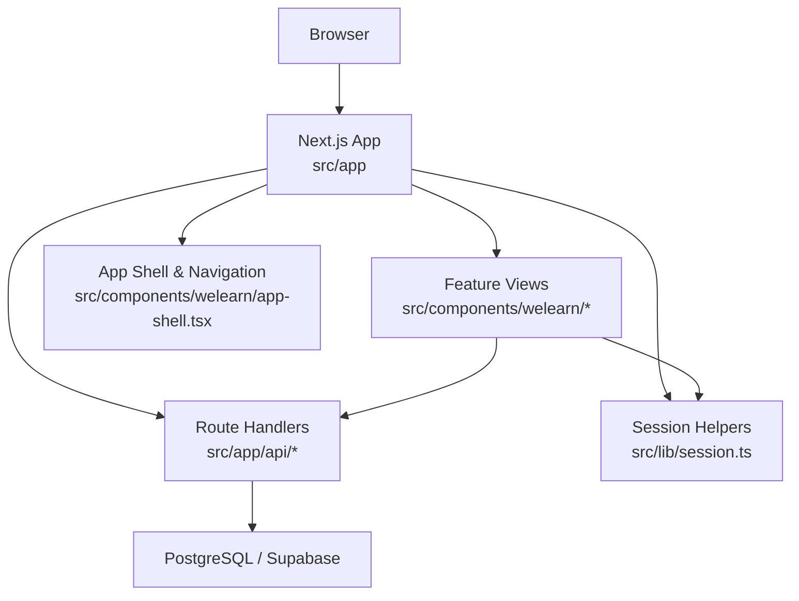
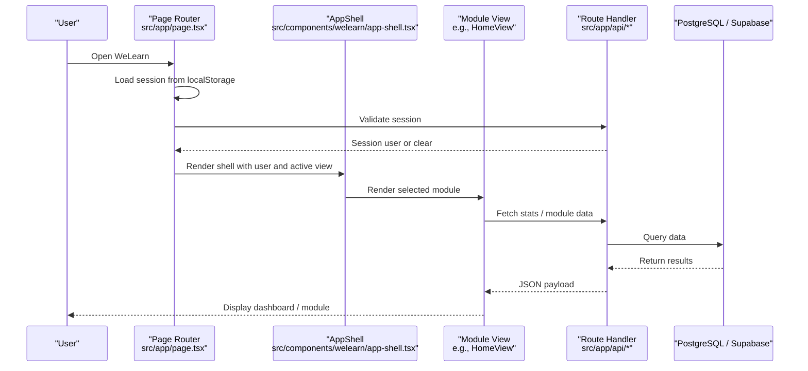
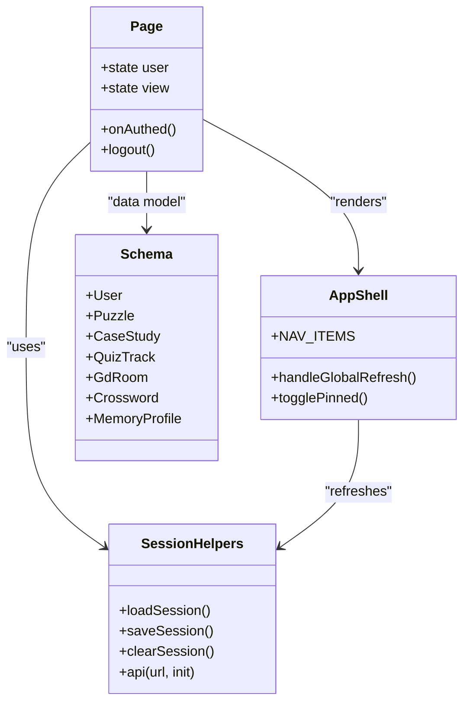
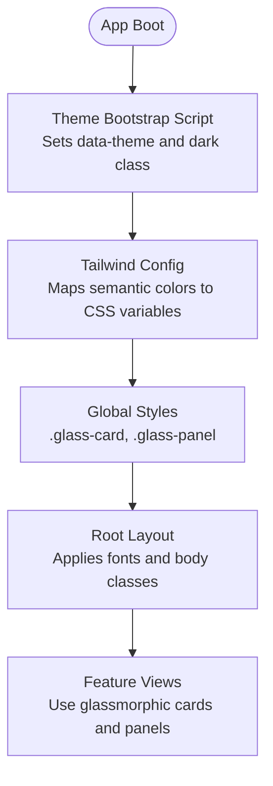
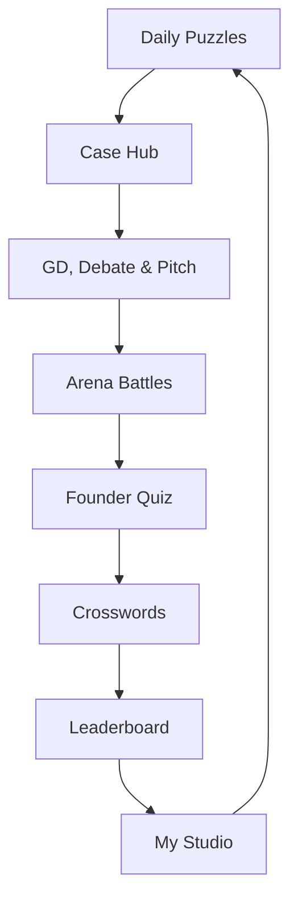
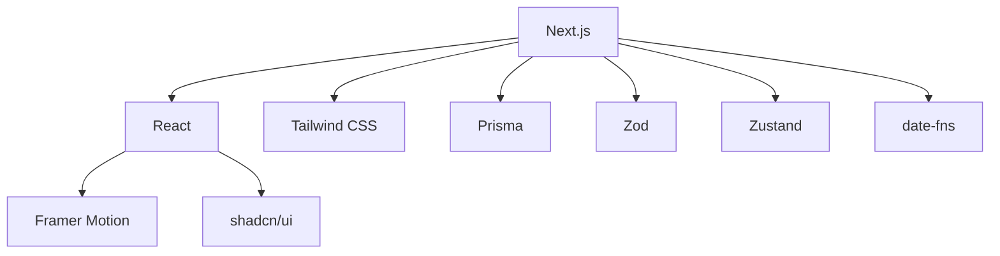

# Project Overview

<cite>
**Referenced Files in This Document**
- [README.md](file://README.md)
- [package.json](file://package.json)
- [src/app/layout.tsx](file://src/app/layout.tsx)
- [src/app/page.tsx](file://src/app/page.tsx)
- [src/components/welearn/app-shell.tsx](file://src/components/welearn/app-shell.tsx)
- [src/components/welearn/home-view.tsx](file://src/components/welearn/home-view.tsx)
- [src/lib/session.ts](file://src/lib/session.ts)
- [prisma/schema.prisma](file://prisma/schema.prisma)
- [tailwind.config.ts](file://tailwind.config.ts)
- [src/app/globals.css](file://src/app/globals.css)
</cite>

## Table of Contents
1. [Introduction](#introduction)
2. [Project Structure](#project-structure)
3. [Core Components](#core-components)
4. [Architecture Overview](#architecture-overview)
5. [Detailed Component Analysis](#detailed-component-analysis)
6. [Dependency Analysis](#dependency-analysis)
7. [Performance Considerations](#performance-considerations)
8. [Troubleshooting Guide](#troubleshooting-guide)
9. [Conclusion](#conclusion)

## Introduction
WeLearn is an entrepreneurship preparation platform built for E-Cell teams to train like founders before events such as E-Summit. Its mission is founder-grade training through interactive, gamified modules: timed puzzles, startup case teardowns, a shared video learning zone with peer quizzes, live arena battle rooms for group discussion, debate, and pitching, founder-mode quizzes, pitch-deck challenges, a multi-metric leaderboard, and personal analytics. The platform combines practical entrepreneurship skills with gamification elements such as streaks, points, star ratings, Elo-style ranking, badges, flashcards, and adaptive crosswords.

The target audience includes E-Cell members, startup enthusiasts, and entrepreneurship students who want structured practice, peer feedback, and measurable progress. Key use cases include:
- Arena battles where participants join GD, Debate, or Pitching rooms, receive star ratings, and earn points and Elo deltas.
- Founder quizzes across investment, growth, operations & legal, product, and strategy tracks, including red-flag audits, micro-math drills, and pitch pairing.
- Case studies and a Video Zone where users watch curated or member-added videos, answer peer questions, post their own questions, and mark content watched.
- Collaborative learning through peer remarks, leaderboards, and studio analytics that show activity, module breakdown, and streaks.

The unique value proposition is the combination of real-world entrepreneurial practice with game-like engagement: time pressure, scoring, rankings, peer evaluation, and adaptive memory tools.

**Section sources**
- [README.md:1-10](file://README.md#L1-L10)
- [README.md:63-103](file://README.md#L63-L103)

## Project Structure
At a high level, WeLearn is a Next.js 16 application using TypeScript, Tailwind CSS, Prisma, and PostgreSQL (with Supabase support). The frontend is organized into app routes, reusable UI components, feature views under `components/welearn`, and client-side libraries for session handling, API calls, and utilities. The backend uses Next.js Route Handlers under `app/api` for authentication, arena state, quiz data, case content, crosswords, leaderboard stats, and more. Data modeling is centralized in Prisma, with migrations and seed scripts supporting local development and deployment.

**Diagram sources**
- [src/app/page.tsx:1-105](file://src/app/page.tsx#L1-L105)
- [src/components/welearn/app-shell.tsx:1-325](file://src/components/welearn/app-shell.tsx#L1-L325)
- [src/lib/session.ts:1-43](file://src/lib/session.ts#L1-L43)
- [prisma/schema.prisma:1-641](file://prisma/schema.prisma#L1-L641)

**Section sources**
- [package.json:1-96](file://package.json#L1-L96)
- [src/app/page.tsx:1-105](file://src/app/page.tsx#L1-L105)
- [src/components/welearn/app-shell.tsx:1-325](file://src/components/welearn/app-shell.tsx#L1-L325)
- [prisma/schema.prisma:1-641](file://prisma/schema.prisma#L1-L641)

## Core Components
WeLearn’s core user experience is composed of several interconnected modules:
- Daily Puzzles: Timed entrepreneurship math/logic/strategy challenges with speed bonuses and streak tracking.
- Case Hub: Case studies, Video Zone, founder-case prompts, and PPT challenges with peer ratings.
- GD, Debate & Pitch: Solo drills with AI-generated topics and speaker timers.
- Arena: Live battle rooms with mode-specific star ratings, MVP selection, Elo updates, and minutes-of-meeting summaries.
- Founder Quiz: Multi-track scenario-based quizzes, red-flag audits, micro-math drills, pitch pairing, and flashcards.
- Crosswords: Adaptive vocabulary engine with SRS, SWOT profiling, hearts, and auto-generated puzzles.
- Leaderboard: Multi-metric ranking by points, arena stars, puzzles, quiz performance, videos, answers, decks, and streaks.
- My Studio: Personal analytics, 30-day activity, module breakdown, peer remarks, and PIN management.

These modules are navigated via a glassmorphic sidebar and header, with each view rendered conditionally based on the current route state.

**Section sources**
- [README.md:63-103](file://README.md#L63-L103)
- [src/components/welearn/app-shell.tsx:31-41](file://src/components/welearn/app-shell.tsx#L31-L41)
- [src/components/welearn/home-view.tsx:37-46](file://src/components/welearn/home-view.tsx#L37-L46)

## Architecture Overview
WeLearn follows a modern full-stack architecture:
- Frontend: React components built with Next.js 16, styled with Tailwind CSS and shadcn/ui primitives, animated with Framer Motion, and themed with a dark-first glassmorphism design system.
- Backend: Next.js Route Handlers expose REST endpoints for auth, arena state, quiz data, case content, crosswords, leaderboard stats, and user statistics.
- Database: Prisma models define entities for users, attempts, cases, quizzes, arena sessions, video content, founder cases, PPT uploads, crosswords, and memory profiles. The database provider is PostgreSQL, with Supabase migration support.
- State Management: Lightweight client-side session storage in localStorage, validated against the server; global refresh events coordinate UI updates.

**Diagram sources**
- [src/app/page.tsx:17-105](file://src/app/page.tsx#L17-L105)
- [src/components/welearn/app-shell.tsx:54-325](file://src/components/welearn/app-shell.tsx#L54-L325)
- [src/lib/session.ts:1-43](file://src/lib/session.ts#L1-L43)
- [prisma/schema.prisma:11-48](file://prisma/schema.prisma#L11-L48)

## Detailed Component Analysis

### Platform Purpose and Mission
WeLearn exists to prepare E-Cell teams for real entrepreneurial challenges through founder-grade training. It emphasizes practical skills over passive learning: timed problem-solving, case analysis, peer-reviewed presentations, live discussions, and scenario-based quizzes. The platform also fosters ecosystem development by encouraging collaboration, peer feedback, and continuous improvement through analytics and leaderboards.

Key outcomes include:
- Improved communication, leadership, and analytical thinking through GD, Debate, and Pitching drills.
- Stronger startup literacy through case studies, founder-case prompts, and pitch-deck challenges.
- Sustained engagement through gamification: streaks, points, badges, star ratings, and adaptive learning tools.

**Section sources**
- [README.md:1-10](file://README.md#L1-L10)
- [README.md:63-103](file://README.md#L63-L103)

### Technology Stack
WeLearn uses:
- Next.js 16 for routing, server components, and API routes.
- TypeScript for type safety across frontend and backend code.
- Tailwind CSS v4 for utility-first styling, extended with custom theme variables and animations.
- Prisma for schema definition and database access, targeting PostgreSQL (and Supabase).
- Additional libraries include Framer Motion for animations, shadcn/ui for accessible components, Zustand for lightweight state, and date-fns for time handling.

**Section sources**
- [package.json:16-82](file://package.json#L16-L82)
- [tailwind.config.ts:1-65](file://tailwind.config.ts#L1-L65)
- [prisma/schema.prisma:1-10](file://prisma/schema.prisma#L1-L10)

### Architectural Approach
The application separates concerns between UI views, navigation shell, session management, and API routes:
- `src/app/page.tsx` orchestrates authentication, session restoration, and view rendering.
- `src/components/welearn/app-shell.tsx` provides the sidebar, header, mobile chip navigation, and global refresh behavior.
- `src/lib/session.ts` manages localStorage-backed sessions and a typed API helper.
- `src/app/api/*` implements modular endpoints for domain features.
- `prisma/schema.prisma` defines the canonical data model, ensuring consistency across modules.

**Diagram sources**
- [src/app/page.tsx:17-105](file://src/app/page.tsx#L17-L105)
- [src/components/welearn/app-shell.tsx:31-325](file://src/components/welearn/app-shell.tsx#L31-L325)
- [src/lib/session.ts:1-43](file://src/lib/session.ts#L1-L43)
- [prisma/schema.prisma:11-641](file://prisma/schema.prisma#L11-L641)

### Glassmorphism Dark-First UI Design
The UI is designed around a dark-first aesthetic with glassmorphic panels and cards. The root layout sets a dark theme bootstrap script to avoid flash during hydration, while Tailwind configuration maps semantic color tokens to CSS variables. Global styles define `.glass-card` and `.glass-panel` classes with backdrop blur, saturation, and subtle borders, creating layered depth. Multiple themes are supported via `data-theme` attributes, including dark-plus, pink-moon, yellow-nitro, dracula, monokai-pro, one-dark, abyss, synthwave-84, and everglades.

**Diagram sources**
- [src/app/layout.tsx:28-70](file://src/app/layout.tsx#L28-L70)
- [tailwind.config.ts:11-65](file://tailwind.config.ts#L11-L65)
- [src/app/globals.css:480-495](file://src/app/globals.css#L480-L495)

**Section sources**
- [src/app/layout.tsx:28-70](file://src/app/layout.tsx#L28-L70)
- [tailwind.config.ts:1-65](file://tailwind.config.ts#L1-L65)
- [src/app/globals.css:480-495](file://src/app/globals.css#L480-L495)

### Module Interactions and Learning Flow
Modules work together to create a comprehensive learning experience:
- Daily Puzzles build quick decision-making and estimation skills.
- Case Hub deepens startup literacy through video teardowns, peer quizzes, and presentation challenges.
- GD, Debate & Pitch drills improve communication and persuasion.
- Arena brings these skills together in live, rated sessions with Elo tracking and MoM summaries.
- Founder Quiz reinforces terminology, strategic thinking, and pitch crafting.
- Crosswords provide adaptive vocabulary reinforcement with memory profiling.
- Leaderboard and My Studio consolidate metrics, streaks, and peer feedback.

[No sources needed since this diagram shows conceptual workflow, not actual code structure]

**Section sources**
- [README.md:63-103](file://README.md#L63-L103)
- [src/components/welearn/home-view.tsx:37-46](file://src/components/welearn/home-view.tsx#L37-L46)

## Dependency Analysis
WeLearn’s dependencies reflect a modern, component-driven architecture:
- Next.js provides routing, server functions, and API handlers.
- React and ReactDOM power the UI layer.
- Tailwind CSS and shadcn/ui enable rapid, accessible UI development.
- Prisma abstracts database interactions with a strongly typed client.
- Framer Motion adds smooth transitions and animations.
- Zustand offers lightweight state management where needed.
- Date-fns and other utilities support time formatting and calculations.

**Diagram sources**
- [package.json:16-82](file://package.json#L16-L82)

**Section sources**
- [package.json:16-82](file://package.json#L16-L82)

## Performance Considerations
- Server-side data fetching via Next.js Route Handlers reduces client bundle size and improves initial load performance.
- Localized session validation minimizes unnecessary network requests after initial login.
- Tailwind’s utility-first approach enables tree-shaking and minimal CSS output.
- Prisma’s generated client ensures efficient queries and type safety.
- Animations are constrained to non-critical paths to maintain responsiveness.

[No sources needed since this section provides general guidance]

## Troubleshooting Guide
Common issues and resolutions:
- Session persistence failures: Ensure localStorage is available and not blocked by browser settings. The session helper gracefully handles parse errors and missing keys.
- API errors: The typed API helper throws descriptive errors when responses are not OK; inspect network logs and verify environment variables such as DATABASE_URL and GROQ_API_KEY.
- Theme flash: The pre-paint theme bootstrap script prevents flashing by setting the theme before hydration; ensure the script runs successfully.
- Database connectivity: For Supabase deployments, confirm connection strings and Prisma provider settings match the README instructions.

**Section sources**
- [src/lib/session.ts:11-42](file://src/lib/session.ts#L11-L42)
- [README.md:34-59](file://README.md#L34-L59)
- [src/app/layout.tsx:43-49](file://src/app/layout.tsx#L43-L49)

## Conclusion
WeLearn delivers founder-grade entrepreneurship training through a cohesive set of interactive modules, combining gamification with practical skills. Its architecture leverages Next.js, TypeScript, Tailwind CSS, Prisma, and PostgreSQL to provide a responsive, scalable platform for E-Cell teams. The glassmorphism dark-first UI enhances focus and engagement, while modules like Arena, Founder Quiz, Case Hub, and Crosswords work together to build communication, analytical, and entrepreneurial competencies. With leaderboards, analytics, and peer feedback, WeLearn supports sustained learning and ecosystem development.

[No sources needed since this section summarizes without analyzing specific files]