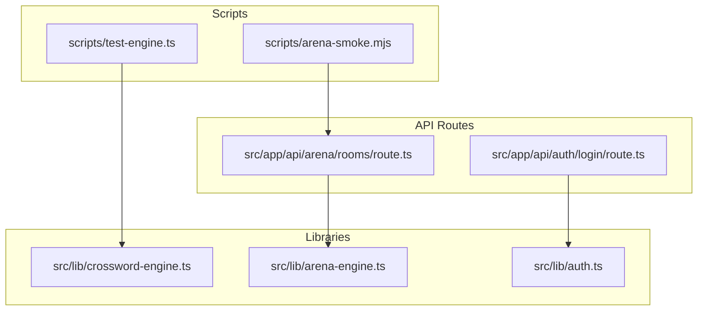
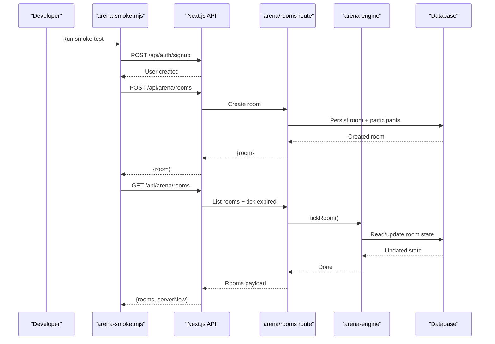
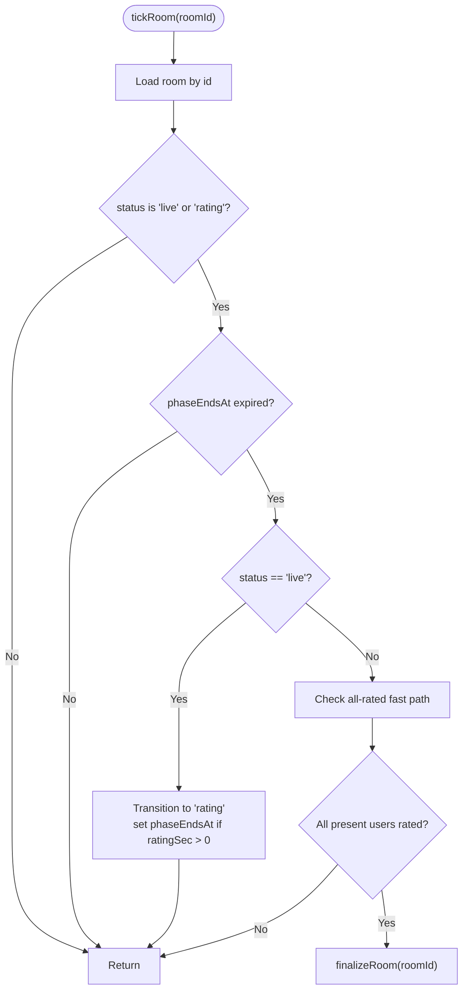
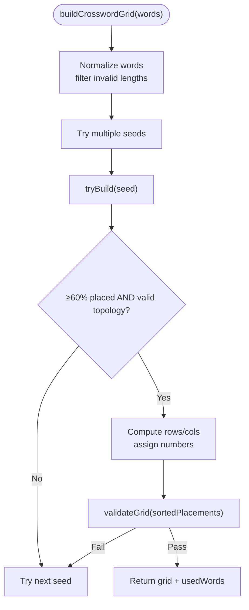
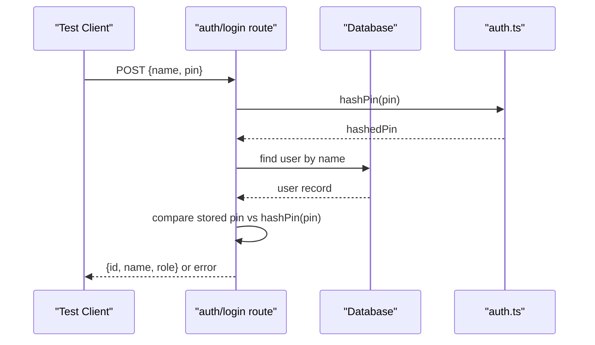
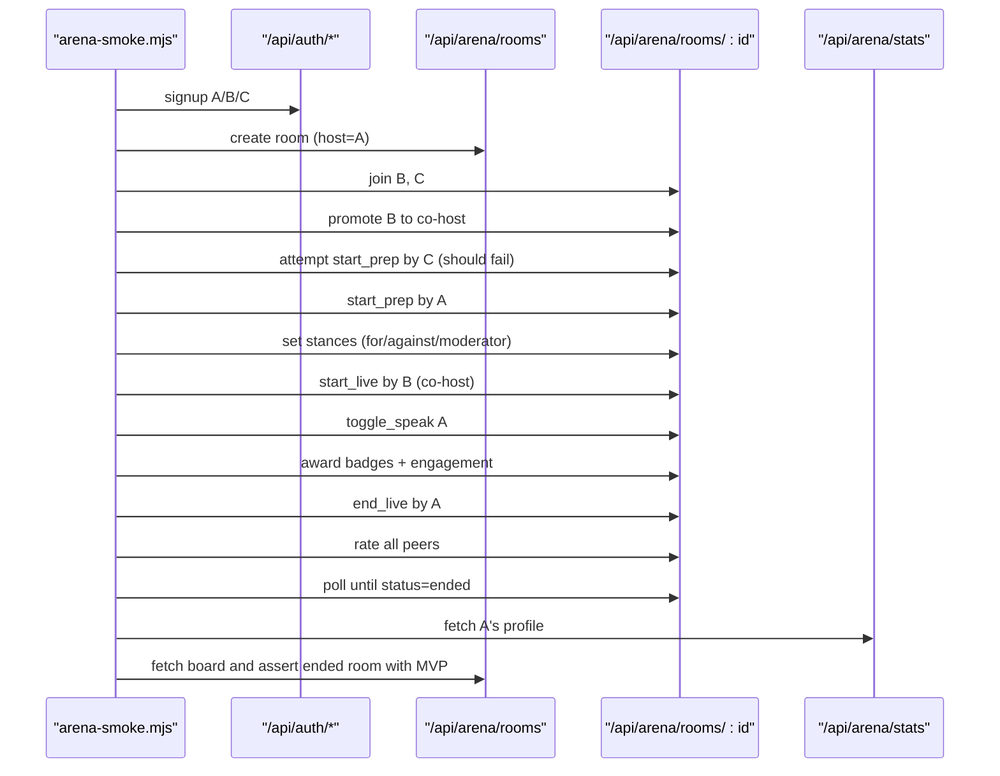
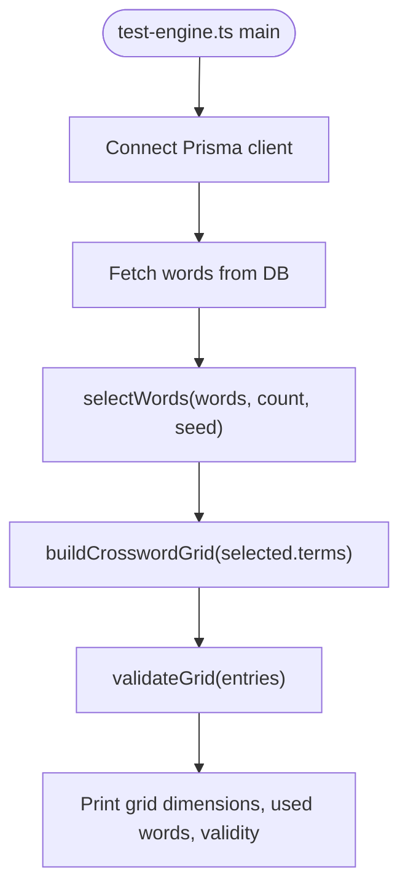
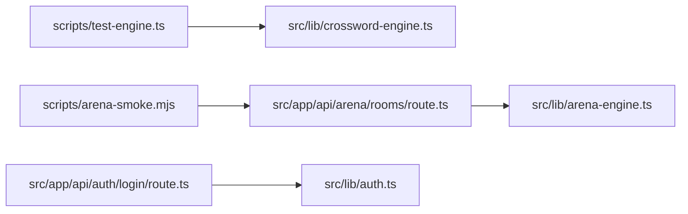

# Testing Strategy

<cite>
**Referenced Files in This Document**
- [package.json](file://package.json)
- [README.md](file://README.md)
- [scripts/test-engine.ts](file://scripts/test-engine.ts)
- [scripts/arena-smoke.mjs](file://scripts/arena-smoke.mjs)
- [src/lib/crossword-engine.ts](file://src/lib/crossword-engine.ts)
- [src/lib/arena-engine.ts](file://src/lib/arena-engine.ts)
- [src/lib/auth.ts](file://src/lib/auth.ts)
- [src/app/api/arena/rooms/route.ts](file://src/app/api/arena/rooms/route.ts)
- [src/app/api/auth/login/route.ts](file://src/app/api/auth/login/route.ts)
</cite>

## Table of Contents
1. [Introduction](#introduction)
2. [Project Structure](#project-structure)
3. [Core Components](#core-components)
4. [Architecture Overview](#architecture-overview)
5. [Detailed Component Analysis](#detailed-component-analysis)
6. [Dependency Analysis](#dependency-analysis)
7. [Performance Considerations](#performance-considerations)
8. [Troubleshooting Guide](#troubleshooting-guide)
9. [Conclusion](#conclusion)
10. [Appendices](#appendices)

## Introduction
This document describes WeLearn’s testing strategy across unit, component, integration, end-to-end (E2E), performance, and load testing. It focuses on:
- Business logic engines: Arena engine and Crossword generation engine
- API endpoint integration tests for Arena rooms and Authentication flows
- Test environment setup, mocking strategies, and test data management
- E2E lifecycle validation, performance and load considerations
- Continuous integration, automated execution, quality gates, coverage expectations, and debugging guidance

The repository currently includes:
- A Node-based smoke test for the Arena API lifecycle
- A script to sanity-check crossword grid generation against a seeded word bank
- Server-side business logic modules for Arena and Crosswords
- Minimal authentication helpers and Next.js API routes

## Project Structure
WeLearn is a Next.js application with server-side business logic under src/lib and API routes under src/app/api. Testing-related scripts live under scripts/. There are no dedicated test frameworks or configuration files present in the repository at this time.

**Diagram sources**
- [scripts/test-engine.ts:1-37](file://scripts/test-engine.ts#L1-L37)
- [scripts/arena-smoke.mjs:1-146](file://scripts/arena-smoke.mjs#L1-L146)
- [src/lib/crossword-engine.ts:1-362](file://src/lib/crossword-engine.ts#L1-L362)
- [src/lib/arena-engine.ts:1-415](file://src/lib/arena-engine.ts#L1-L415)
- [src/lib/auth.ts:1-26](file://src/lib/auth.ts#L1-L26)
- [src/app/api/arena/rooms/route.ts:1-115](file://src/app/api/arena/rooms/route.ts#L1-L115)
- [src/app/api/auth/login/route.ts:1-26](file://src/app/api/auth/login/route.ts#L1-L26)

**Section sources**
- [package.json:1-96](file://package.json#L1-L96)
- [README.md:1-104](file://README.md#L1-L104)

## Core Components
This section outlines the primary testing targets and how they are exercised today.

- Arena Engine (server-side):
  - Lifecycle transitions: lobby → prep → live → rating → ended
  - Timers and phaseEndsAt synchronization
  - Rating aggregation, badges, Elo deltas, streaks, MoM generation
  - Coaching suggestions based on aggregated stats

- Crossword Engine (server-side):
  - Word selection with usage heuristics
  - Backtracking grid builder with crossing constraints
  - Grid validation and compactness optimization
  - Clue safety checks to prevent answer leakage

- Authentication Helpers:
  - PIN hashing and validation
  - Team PIN verification

- API Endpoints:
  - Arena rooms: create room, list sessions board, tick lifecycle
  - Auth login: verify name/PIN and return user identity

**Section sources**
- [src/lib/arena-engine.ts:1-415](file://src/lib/arena-engine.ts#L1-L415)
- [src/lib/crossword-engine.ts:1-362](file://src/lib/crossword-engine.ts#L1-L362)
- [src/lib/auth.ts:1-26](file://src/lib/auth.ts#L1-L26)
- [src/app/api/arena/rooms/route.ts:1-115](file://src/app/api/arena/rooms/route.ts#L1-L115)
- [src/app/api/auth/login/route.ts:1-26](file://src/app/api/auth/login/route.ts#L1-L26)

## Architecture Overview
The current testing approach combines:
- Script-driven smoke tests that call running APIs
- Sanity scripts that exercise pure business logic functions directly

**Diagram sources**
- [scripts/arena-smoke.mjs:1-146](file://scripts/arena-smoke.mjs#L1-L146)
- [src/app/api/arena/rooms/route.ts:1-115](file://src/app/api/arena/rooms/route.ts#L1-L115)
- [src/lib/arena-engine.ts:1-415](file://src/lib/arena-engine.ts#L1-L415)

## Detailed Component Analysis

### Arena Engine Unit Testing Strategy
Focus areas:
- Phase transitions and atomicity
- Timer expiration and fast-path finalization
- Rating aggregation, MVP/badge assignment, Elo clamping
- Streak and radar axis mapping
- Coaching suggestion rules

Recommended unit tests:
- tickRoom transitions from live to rating when phaseEndsAt expires
- finalizeRoom idempotency and atomic claim
- Aspect averages and overall score computation
- Elo delta clamping within bounds
- CoachSuggestions output shape and thresholds

**Diagram sources**
- [src/lib/arena-engine.ts:88-132](file://src/lib/arena-engine.ts#L88-L132)

**Section sources**
- [src/lib/arena-engine.ts:88-132](file://src/lib/arena-engine.ts#L88-L132)
- [src/lib/arena-engine.ts:200-366](file://src/lib/arena-engine.ts#L200-L366)
- [src/lib/arena-engine.ts:368-415](file://src/lib/arena-engine.ts#L368-L415)

### Crossword Generation Unit Testing Strategy
Focus areas:
- selectWords prioritization and length mixing
- Grid builder backtracking and placement rules
- validateGrid connectivity and crossing constraints
- buildCrosswordGrid compactness and numbering
- clueLeaksAnswer safety

Recommended unit tests:
- selectWords returns expected distribution given seed and usage metadata
- tryBuild produces valid placements meeting minimum placement ratio
- validateGrid rejects disconnected graphs and non-crossing words
- buildCrosswordGrid returns consistent grids across multiple seeds
- clueLeaksAnswer detects direct and partial leaks

**Diagram sources**
- [src/lib/crossword-engine.ts:207-255](file://src/lib/crossword-engine.ts#L207-L255)
- [src/lib/crossword-engine.ts:257-344](file://src/lib/crossword-engine.ts#L257-L344)
- [src/lib/crossword-engine.ts:172-198](file://src/lib/crossword-engine.ts#L172-L198)

**Section sources**
- [src/lib/crossword-engine.ts:56-80](file://src/lib/crossword-engine.ts#L56-L80)
- [src/lib/crossword-engine.ts:172-198](file://src/lib/crossword-engine.ts#L172-L198)
- [src/lib/crossword-engine.ts:207-255](file://src/lib/crossword-engine.ts#L207-L255)
- [src/lib/crossword-engine.ts:257-344](file://src/lib/crossword-engine.ts#L257-L344)
- [src/lib/crossword-engine.ts:346-362](file://src/lib/crossword-engine.ts#L346-L362)

### Authentication Flow Integration Testing Strategy
Focus areas:
- Login route validates name/PIN and returns user identity
- PIN hashing consistency
- Error responses for missing users and wrong PINs

Recommended integration tests:
- Successful login with correct name/PIN
- 404 when user not found
- 401 when PIN is incorrect
- HashPin determinism and isValidPin format checks

**Diagram sources**
- [src/app/api/auth/login/route.ts:1-26](file://src/app/api/auth/login/route.ts#L1-L26)
- [src/lib/auth.ts:1-26](file://src/lib/auth.ts#L1-L26)

**Section sources**
- [src/app/api/auth/login/route.ts:1-26](file://src/app/api/auth/login/route.ts#L1-L26)
- [src/lib/auth.ts:1-26](file://src/lib/auth.ts#L1-L26)

### Arena API End-to-End Smoke Test
The smoke test simulates a full 5-stage Arena lifecycle with three concurrent users, covering:
- User creation and login fallback
- Room creation and joining
- Co-host delegation and permission guards
- Prep, stance locking, live start by co-host
- Talk-time tracking, micro-badges, engagement
- Rating submission and auto-finalization
- Stats, leaderboard rank, and sessions board visibility

**Diagram sources**
- [scripts/arena-smoke.mjs:1-146](file://scripts/arena-smoke.mjs#L1-L146)
- [src/app/api/arena/rooms/route.ts:1-115](file://src/app/api/arena/rooms/route.ts#L1-L115)

**Section sources**
- [scripts/arena-smoke.mjs:1-146](file://scripts/arena-smoke.mjs#L1-L146)

### Crossword Sanity Script
The script loads seeded words from the database, selects a subset, builds a grid, validates it, and prints results. It serves as a quick sanity check for the crossword engine.

**Diagram sources**
- [scripts/test-engine.ts:1-37](file://scripts/test-engine.ts#L1-L37)
- [src/lib/crossword-engine.ts:56-80](file://src/lib/crossword-engine.ts#L56-L80)
- [src/lib/crossword-engine.ts:257-344](file://src/lib/crossword-engine.ts#L257-L344)

**Section sources**
- [scripts/test-engine.ts:1-37](file://scripts/test-engine.ts#L1-L37)

## Dependency Analysis
Key dependencies between testing assets and production code:
- scripts/test-engine.ts depends on crossword-engine functions
- scripts/arena-smoke.mjs calls Next.js API endpoints which depend on arena-engine and database
- auth.login route depends on auth helpers

**Diagram sources**
- [scripts/test-engine.ts:1-37](file://scripts/test-engine.ts#L1-L37)
- [scripts/arena-smoke.mjs:1-146](file://scripts/arena-smoke.mjs#L1-L146)
- [src/app/api/arena/rooms/route.ts:1-115](file://src/app/api/arena/rooms/route.ts#L1-L115)
- [src/lib/arena-engine.ts:1-415](file://src/lib/arena-engine.ts#L1-L415)
- [src/app/api/auth/login/route.ts:1-26](file://src/app/api/auth/login/route.ts#L1-L26)
- [src/lib/auth.ts:1-26](file://src/lib/auth.ts#L1-L26)

**Section sources**
- [scripts/test-engine.ts:1-37](file://scripts/test-engine.ts#L1-L37)
- [scripts/arena-smoke.mjs:1-146](file://scripts/arena-smoke.mjs#L1-L146)
- [src/app/api/arena/rooms/route.ts:1-115](file://src/app/api/arena/rooms/route.ts#L1-L115)
- [src/lib/arena-engine.ts:1-415](file://src/lib/arena-engine.ts#L1-L415)
- [src/app/api/auth/login/route.ts:1-26](file://src/app/api/auth/login/route.ts#L1-L26)
- [src/lib/auth.ts:1-26](file://src/lib/auth.ts#L1-L26)

## Performance Considerations
- Arena engine:
  - tickRoom runs on every poll; ensure efficient queries and avoid N+1 patterns
  - finalizeRoom performs multiple DB reads/writes; consider batching where possible
  - Elo and badge computations are O(n) over participants; keep room sizes reasonable

- Crossword engine:
  - tryBuild attempts multiple seeds; limit attemptSeeds to balance quality and latency
  - validateGrid traverses adjacency graph; ensure placement sets remain small

- API endpoints:
  - Arena rooms GET lists recent rooms; paginate or cap results to avoid heavy payloads
  - Auth login scans users by name; consider indexed lookup by normalized name

[No sources needed since this section provides general guidance]

## Troubleshooting Guide
Common issues and diagnostics:
- Arena smoke test failures:
  - Permission guard errors indicate authorization logic mismatch
  - Auto-finalization not triggering suggests rating submission or presence detection issues
  - Stats not updating implies finalizeRoom did not run or DB writes failed

- Crossword sanity script:
  - No grid built indicates insufficient valid words or too strict placement constraints
  - Validation failures point to connectivity or crossing rule violations

- Auth login:
  - Wrong PIN errors require verifying hashPin behavior and stored PIN values
  - Missing user errors suggest seeding or case-sensitivity mismatches

Debugging tips:
- Add structured logs around claimTransition and finalizeRoom entry points
- Inspect room.phaseEndsAt and server clock offsets during tickRoom
- For crossword issues, print intermediate placements and candidate lists

**Section sources**
- [scripts/arena-smoke.mjs:1-146](file://scripts/arena-smoke.mjs#L1-L146)
- [scripts/test-engine.ts:1-37](file://scripts/test-engine.ts#L1-L37)
- [src/lib/arena-engine.ts:88-132](file://src/lib/arena-engine.ts#L88-L132)
- [src/lib/arena-engine.ts:200-366](file://src/lib/arena-engine.ts#L200-L366)
- [src/lib/crossword-engine.ts:207-255](file://src/lib/crossword-engine.ts#L207-L255)
- [src/app/api/auth/login/route.ts:1-26](file://src/app/api/auth/login/route.ts#L1-L26)

## Conclusion
WeLearn’s testing foundation currently relies on:
- Script-driven smoke tests for Arena API lifecycle
- Sanity scripts for crossword engine validation
- Direct invocation of pure business logic functions

To mature the testing program, introduce a formal test framework, expand unit coverage for both engines, add component tests for UI interactions, and establish CI pipelines with automated execution and quality gates.

[No sources needed since this section summarizes without analyzing specific files]

## Appendices

### Test Environment Setup
- Install dependencies and generate Prisma client
- Push schema to local or Supabase database
- Seed content required by tests
- Start dev server before running smoke tests

**Section sources**
- [package.json:1-96](file://package.json#L1-L96)
- [README.md:11-18](file://README.md#L11-L18)

### Mocking Strategies
- Database layer:
  - Use an isolated test database instance
  - Seed deterministic fixtures for users, rooms, and ratings
- External services:
  - Mock AI generation calls (e.g., Groq) with deterministic outputs
- Time-sensitive logic:
  - Control Date.now() via a test clock for timer assertions

[No sources needed since this section provides general guidance]

### Test Data Management
- Users:
  - Pre-seed host, co-host, and participant roles
- Arena rooms:
  - Fixture rooms in various states (lobby, prep, live, rating, ended)
- Crosswords:
  - Curated word banks with known properties for predictable grid outcomes

[No sources needed since this section provides general guidance]

### End-to-End Testing Approaches
- API-level E2E:
  - Replicate multi-user workflows similar to arena-smoke.mjs
- UI-level E2E:
  - Simulate user actions through browser automation
  - Assert visual states and network requests

[No sources needed since this section provides general guidance]

### Performance and Load Testing
- Arena:
  - Simulate concurrent polls and rating submissions
  - Measure tickRoom and finalizeRoom latencies under load
- Crossword:
  - Stress test buildCrosswordGrid with large word sets
  - Monitor CPU and memory usage during repeated attempts

[No sources needed since this section provides general guidance]

### Continuous Integration and Quality Gates
- Automated execution:
  - Run smoke tests against a running dev server in CI
  - Execute crossword sanity checks after builds
- Quality gates:
  - Enforce linting and type checks
  - Require passing smoke and sanity scripts before merge
- Coverage requirements:
  - Establish minimum coverage thresholds for critical modules (Arena engine, Crossword engine, Auth helpers)

**Section sources**
- [package.json:1-96](file://package.json#L1-L96)
- [scripts/arena-smoke.mjs:1-146](file://scripts/arena-smoke.mjs#L1-L146)
- [scripts/test-engine.ts:1-37](file://scripts/test-engine.ts#L1-L37)

### Best Practices
- Deterministic tests:
  - Use fixed seeds for randomization in engines
- Idempotency:
  - Ensure finalizeRoom and other transitions are safe to retry
- Clear assertions:
  - Validate both success paths and error responses
- Observability:
  - Log key transitions and metrics for failing scenarios

[No sources needed since this section provides general guidance]