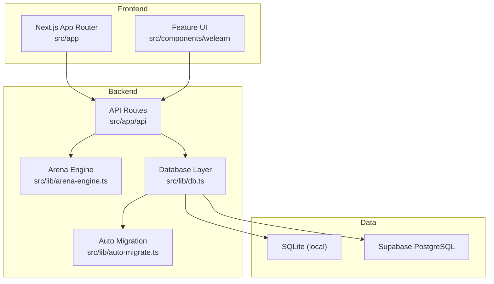
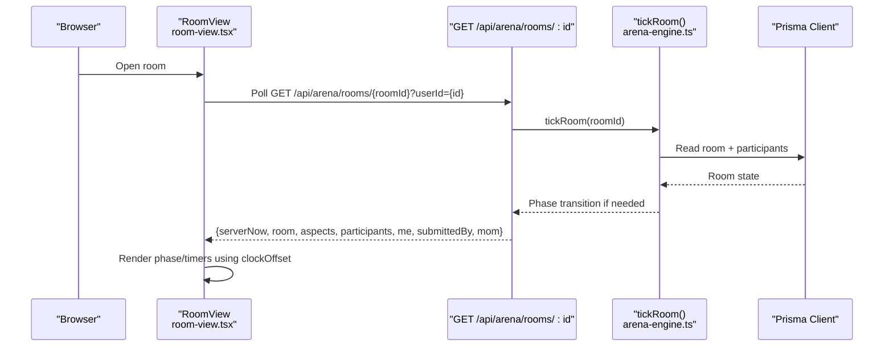
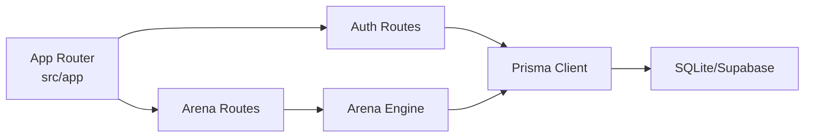

# Troubleshooting & FAQ

<cite>
**Referenced Files in This Document**
- [README.md](file://README.md)
- [SETUP (2).md](file://SETUP%20(2).md)
- [package.json](file://package.json)
- [src/lib/db.ts](file://src/lib/db.ts)
- [src/lib/auto-migrate.ts](file://src/lib/auto-migrate.ts)
- [src/lib/auth.ts](file://src/lib/auth.ts)
- [src/app/api/auth/login/route.ts](file://src/app/api/auth/login/route.ts)
- [src/app/api/auth/signup/route.ts](file://src/app/api/auth/signup/route.ts)
- [src/app/api/auth/change-pin/route.ts](file://src/app/api/auth/change-pin/route.ts)
- [src/app/api/auth/validate/route.ts](file://src/app/api/auth/validate/route.ts)
- [src/app/page.tsx](file://src/app/page.tsx)
- [src/components/welearn/auth-screen.tsx](file://src/components/welearn/auth-screen.tsx)
- [src/app/api/arena/rooms/route.ts](file://src/app/api/arena/rooms/route.ts)
- [src/app/api/arena/rooms/[id]/route.ts](file://src/app/api/arena/rooms/[id]/route.ts)
- [src/lib/arena-engine.ts](file://src/lib/arena-engine.ts)
- [src/components/welearn/arena/room-view.tsx](file://src/components/welearn/arena/room-view.tsx)
- [scripts/migrate-sqlite-to-supabase.ts](file://scripts/migrate-sqlite-to-supabase.ts)
- [scripts/arena-smoke.mjs](file://scripts/arena-smoke.mjs)
</cite>

## Table of Contents
1. [Introduction](#introduction)
2. [Project Structure](#project-structure)
3. [Core Components](#core-components)
4. [Architecture Overview](#architecture-overview)
5. [Detailed Component Analysis](#detailed-component-analysis)
6. [Dependency Analysis](#dependency-analysis)
7. [Performance Considerations](#performance-considerations)
8. [Troubleshooting Guide](#troubleshooting-guide)
9. [Conclusion](#conclusion)
10. [Appendices](#appendices)

## Introduction
This document provides a comprehensive troubleshooting and FAQ guide for the WeLearn E-Cell Prep Platform. It focuses on resolving database connection problems, environment configuration errors, deployment issues, arena synchronization failures, authentication errors, API errors, performance bottlenecks, memory leaks, browser compatibility, mobile responsiveness, accessibility concerns, logging strategies, diagnostic tools, and error reporting mechanisms. It also includes step-by-step resolution guides for common setup and configuration questions.

## Project Structure
WeLearn is a Next.js 16 application with TypeScript, Tailwind 4, shadcn/ui, Prisma, SQLite or Supabase PostgreSQL, and optional Groq AI integration. The repository organizes code by feature:
- `src/app/api` — server routes for auth, arena, quiz, cases, words, etc.
- `src/components/welearn` — feature UI components including Arena, Quiz, Cases, GD, Puzzles, Leaderboard, Studio.
- `src/lib` — shared logic for database access, auto-migration, authentication, arena engine, helpers, and seed data.
- `prisma/schema.prisma` — data model used by Prisma.
- `supabase/migrations` — SQL migrations for Supabase.
- `scripts` — utilities for seeding, migration, and smoke tests.

**Diagram sources**
- [src/app/page.tsx:23-50](file://src/app/page.tsx#L23-L50)
- [src/app/api/arena/rooms/route.ts:8-79](file://src/app/api/arena/rooms/route.ts#L8-L79)
- [src/lib/db.ts:1-50](file://src/lib/db.ts#L1-L50)
- [src/lib/auto-migrate.ts:414-583](file://src/lib/auto-migrate.ts#L414-L583)

**Section sources**
- [README.md:1-104](file://README.md#L1-L104)
- [SETUP (2).md:1-122](file://SETUP%20(2).md#L1-L122)
- [package.json:1-96](file://package.json#L1-L96)

## Core Components
- Database layer: Centralized Prisma client with environment-aware URL resolution and query logging.
- Auto-migration: Bootstraps schema and seeds content when tables are missing; ensures admin user exists.
- Authentication: PIN-based login/signup with hashed storage, team PIN validation, and session validation endpoint.
- Arena system: Server-authoritative room lifecycle, participant tracking, star ratings, Elo scoring, and Minutes-of-Meeting generation.
- Frontend sessions: Optimistic localStorage session restore with server-side validation.

**Section sources**
- [src/lib/db.ts:1-50](file://src/lib/db.ts#L1-L50)
- [src/lib/auto-migrate.ts:414-602](file://src/lib/auto-migrate.ts#L414-L602)
- [src/lib/auth.ts:1-26](file://src/lib/auth.ts#L1-L26)
- [src/app/api/auth/login/route.ts:1-25](file://src/app/api/auth/login/route.ts#L1-L25)
- [src/app/api/auth/signup/route.ts:1-35](file://src/app/api/auth/signup/route.ts#L1-L35)
- [src/app/api/auth/validate/route.ts:1-16](file://src/app/api/auth/validate/route.ts#L1-L16)
- [src/app/page.tsx:23-50](file://src/app/page.tsx#L23-L50)
- [src/lib/arena-engine.ts:1-415](file://src/lib/arena-engine.ts#L1-L415)

## Architecture Overview
The platform uses a polling-based sync model for Arena rooms. Clients poll the room endpoint every ~1.5 seconds to receive state updates and synchronize timers using a server-clock offset. The server advances room phases based on wall-clock time and enforces atomic transitions.

**Diagram sources**
- [src/components/welearn/arena/room-view.tsx:25-62](file://src/components/welearn/arena/room-view.tsx#L25-L62)
- [src/app/api/arena/rooms/[id]/route.ts:10-124](file://src/app/api/arena/rooms/[id]/route.ts#L10-L124)
- [src/lib/arena-engine.ts:88-132](file://src/lib/arena-engine.ts#L88-L132)

## Detailed Component Analysis

### Database Connection Problems
Symptoms:
- Login/signup fails with “Database tables missing” or Prisma errors.
- Supabase connection errors or timeouts.
- Local SQLite path not found.

Root causes:
- Missing or incorrect `DATABASE_URL`.
- New Supabase project without tables.
- Vercel serverless connection limits without pgbouncer.

Resolution steps:
1. Verify environment variables:
   - For local SQLite: ensure `DATABASE_URL=file:./db/custom.db` or absolute path.
   - For Supabase: set `DATABASE_URL=postgresql://...` with pgbouncer parameters if deploying to Vercel.
2. Ensure auto-migration runs:
   - On first request, `ensureDbReady()` detects missing tables and runs `runAutoMigration()`, which creates all tables and seeds default data.
3. If using Supabase directly:
   - Run `npx prisma db push` after setting `DATABASE_URL`.
   - Optionally run `npm run db:migrate-all` to generate idempotent SQL from SQLite.

Diagnostics:
- Check server logs for “Auto-migrating Supabase PostgreSQL schema...” and “Auto-migration complete!” messages.
- Confirm that the admin user “E-Cell Admin” is created automatically.

References:
- [src/lib/db.ts:7-47](file://src/lib/db.ts#L7-L47)
- [src/lib/auto-migrate.ts:414-583](file://src/lib/auto-migrate.ts#L414-L583)
- [src/lib/auto-migrate.ts:588-602](file://src/lib/auto-migrate.ts#L588-L602)
- [README.md:34-61](file://README.md#L34-L61)
- [SETUP (2).md:22-49](file://SETUP%20(2).md#L22-L49)
- [scripts/migrate-sqlite-to-supabase.ts:244-280](file://scripts/migrate-sqlite-to-supabase.ts#L244-L280)

**Section sources**
- [src/lib/db.ts:1-50](file://src/lib/db.ts#L1-L50)
- [src/lib/auto-migrate.ts:414-602](file://src/lib/auto-migrate.ts#L414-L602)
- [README.md:34-61](file://README.md#L34-L61)
- [SETUP (2).md:22-49](file://SETUP%20(2).md#L22-L49)
- [scripts/migrate-sqlite-to-supabase.ts:244-280](file://scripts/migrate-sqlite-to-supabase.ts#L244-L280)

### Environment Configuration Errors
Common issues:
- Missing `GROQ_API_KEY` disables live AI generation (fallback to curated banks).
- Incorrect `TEAM_PIN` prevents deletion actions requiring team PIN.
- Wrong `AUTH_SALT` changes pin hashing behavior.

Resolution steps:
1. Add `GROQ_API_KEY` to `.env` to enable AI features.
2. Set `TEAM_PIN` to change the 2-step confirmation PIN for shared content operations.
3. Change `AUTH_SALT` only if you control pin hashing across environments; otherwise keep default.

Verification:
- Without `GROQ_API_KEY`, AI endpoints fall back to curated content.
- Team PIN checks use `isTeamPin(pin)` in delete-room flows.

References:
- [README.md:24-32](file://README.md#L24-L32)
- [src/lib/auth.ts:1-26](file://src/lib/auth.ts#L1-L26)
- [src/app/api/arena/rooms/[id]/route.ts:168-177](file://src/app/api/arena/rooms/[id]/route.ts#L168-L177)

**Section sources**
- [README.md:24-32](file://README.md#L24-L32)
- [src/lib/auth.ts:1-26](file://src/lib/auth.ts#L1-L26)
- [src/app/api/arena/rooms/[id]/route.ts:168-177](file://src/app/api/arena/rooms/[id]/route.ts#L168-L177)

### Deployment Issues
Vercel-specific notes:
- Use pgbouncer in `DATABASE_URL` for serverless concurrency.
- Run `prisma generate` postinstall.
- PPT uploads require blob storage since `/public/uploads/ppts/` is read-only on Vercel.

Resolution steps:
1. Configure environment variables: `DATABASE_URL`, `GROQ_API_KEY`, optional `TEAM_PIN`.
2. Add `"postinstall": "prisma generate"` to package scripts.
3. Replace local file upload with Supabase Storage or Vercel Blob for PPTs.

References:
- [README.md:51-61](file://README.md#L51-L61)
- [package.json:5-14](file://package.json#L5-L14)

**Section sources**
- [README.md:51-61](file://README.md#L51-L61)
- [package.json:5-14](file://package.json#L5-L14)

### Arena Synchronization Problems
Symptoms:
- Room state not updating or stale timers.
- Participants appear offline despite being present.
- Rating phase does not finalize.

Causes:
- Network latency causing stale lastSeen timestamps.
- Server-clock drift between client and server.
- Concurrent phase transitions not properly claimed.

Resolution steps:
1. Ensure clients poll at ~1.5s intervals and render timers using `clockOffset = serverNow - Date.now()`.
2. Validate presence heartbeat: GET room updates `lastSeen` if stale (>5s).
3. Confirm server-side `tickRoom` advances phases atomically via `claimTransition`.

Diagnostics:
- Inspect room polling loop and toast errors in `RoomView`.
- Use smoke test script to validate talk-time accumulation and badge aggregation.

References:
- [src/components/welearn/arena/room-view.tsx:25-62](file://src/components/welearn/arena/room-view.tsx#L25-L62)
- [src/app/api/arena/rooms/[id]/route.ts:10-33](file://src/app/api/arena/rooms/[id]/route.ts#L10-L33)
- [src/lib/arena-engine.ts:88-132](file://src/lib/arena-engine.ts#L88-L132)
- [scripts/arena-smoke.mjs:77-94](file://scripts/arena-smoke.mjs#L77-L94)

**Section sources**
- [src/components/welearn/arena/room-view.tsx:25-62](file://src/components/welearn/arena/room-view.tsx#L25-L62)
- [src/app/api/arena/rooms/[id]/route.ts:10-33](file://src/app/api/arena/rooms/[id]/route.ts#L10-L33)
- [src/lib/arena-engine.ts:88-132](file://src/lib/arena-engine.ts#L88-L132)
- [scripts/arena-smoke.mjs:77-94](file://scripts/arena-smoke.mjs#L77-L94)

### Authentication Failures
Symptoms:
- “No member found with that name — sign up first”.
- “Wrong PIN — try again”.
- Session expired after DB reseed.

Resolution steps:
1. Sign up with a unique name and 4-digit PIN.
2. Log in with matching name and PIN; pins are hashed server-side.
3. If session expires, clear localStorage and log in again; the app validates session against DB on startup.

Diagnostics:
- Check login/signup route error responses.
- Validate session via `/api/auth/validate?userId=...`.

References:
- [src/app/api/auth/login/route.ts:6-24](file://src/app/api/auth/login/route.ts#L6-L24)
- [src/app/api/auth/signup/route.ts:6-34](file://src/app/api/auth/signup/route.ts#L6-L34)
- [src/app/api/auth/validate/route.ts:5-15](file://src/app/api/auth/validate/route.ts#L5-L15)
- [src/app/page.tsx:23-50](file://src/app/page.tsx#L23-L50)
- [src/components/welearn/auth-screen.tsx:27-71](file://src/components/welearn/auth-screen.tsx#L27-L71)

**Section sources**
- [src/app/api/auth/login/route.ts:1-25](file://src/app/api/auth/login/route.ts#L1-L25)
- [src/app/api/auth/signup/route.ts:1-35](file://src/app/api/auth/signup/route.ts#L1-L35)
- [src/app/api/auth/validate/route.ts:1-16](file://src/app/api/auth/validate/route.ts#L1-L16)
- [src/app/page.tsx:23-50](file://src/app/page.tsx#L23-L50)
- [src/components/welearn/auth-screen.tsx:27-71](file://src/components/welearn/auth-screen.tsx#L27-L71)

### API Errors
Common patterns:
- Validation errors return JSON `{error: message}` with appropriate HTTP status codes.
- Unknown actions return generic “Unknown action” errors.
- Room operations enforce host/co-host permissions.

Resolution steps:
1. Validate input fields (name length, PIN format, topic length).
2. Ensure correct action names for arena endpoints (`join`, `leave`, `start_live`, `end_live`, `rate`, etc.).
3. Check permission checks for host/co-host roles.

References:
- [src/lib/helpers.ts:39-41](file://src/lib/helpers.ts#L39-L41)
- [src/app/api/arena/rooms/[id]/route.ts:127-291](file://src/app/api/arena/rooms/[id]/route.ts#L127-L291)
- [src/app/api/arena/rooms/route.ts:83-114](file://src/app/api/arena/rooms/route.ts#L83-L114)

**Section sources**
- [src/lib/helpers.ts:1-42](file://src/lib/helpers.ts#L1-L42)
- [src/app/api/arena/rooms/[id]/route.ts:127-291](file://src/app/api/arena/rooms/[id]/route.ts#L127-L291)
- [src/app/api/arena/rooms/route.ts:83-114](file://src/app/api/arena/rooms/route.ts#L83-L114)

### Performance Optimization Tips
- Arena polling interval is 1.5s; avoid reducing it further to prevent excessive server load.
- Use server-authoritative timers to minimize client-server drift.
- Limit room board queries to recent rooms (last 12 hours) and active ones.
- Enable Prisma query logging in development to identify slow queries.

Recommendations:
- Monitor server CPU/memory during peak arena usage.
- Cache static data (modes, aspects) on the client where possible.
- Avoid unnecessary re-renders in room view by memoizing derived data.

References:
- [src/components/welearn/arena/room-view.tsx:25-62](file://src/components/welearn/arena/room-view.tsx#L25-L62)
- [src/app/api/arena/rooms/route.ts:13-37](file://src/app/api/arena/rooms/route.ts#L13-L37)
- [src/lib/db.ts:42-47](file://src/lib/db.ts#L42-L47)

**Section sources**
- [src/components/welearn/arena/room-view.tsx:25-62](file://src/components/welearn/arena/room-view.tsx#L25-L62)
- [src/app/api/arena/rooms/route.ts:13-37](file://src/app/api/arena/rooms/route.ts#L13-L37)
- [src/lib/db.ts:42-47](file://src/lib/db.ts#L42-L47)

### Memory Leak Prevention
- Clear intervals and timers in component cleanup functions (e.g., room polling loop).
- Avoid storing large payloads in global state; prefer localized state per component.
- Reuse Prisma client instance via module-level singleton.

References:
- [src/components/welearn/arena/room-view.tsx:53-57](file://src/components/welearn/arena/room-view.tsx#L53-L57)
- [src/lib/db.ts:42-49](file://src/lib/db.ts#L42-L49)

**Section sources**
- [src/components/welearn/arena/room-view.tsx:53-57](file://src/components/welearn/arena/room-view.tsx#L53-L57)
- [src/lib/db.ts:42-49](file://src/lib/db.ts#L42-L49)

### Bottleneck Identification
- Arena finalization aggregates ratings and computes Elo; ensure this runs once per room via atomic claim.
- Minutes-of-Meeting generation calls Groq AI; consider caching results or limiting frequency.
- Room board queries include participant lists; paginate or filter aggressively in high-traffic scenarios.

References:
- [src/lib/arena-engine.ts:209-366](file://src/lib/arena-engine.ts#L209-L366)
- [src/lib/arena-engine.ts:146-198](file://src/lib/arena-engine.ts#L146-L198)
- [src/app/api/arena/rooms/route.ts:13-37](file://src/app/api/arena/rooms/route.ts#L13-L37)

**Section sources**
- [src/lib/arena-engine.ts:209-366](file://src/lib/arena-engine.ts#L209-L366)
- [src/lib/arena-engine.ts:146-198](file://src/lib/arena-engine.ts#L146-L198)
- [src/app/api/arena/rooms/route.ts:13-37](file://src/app/api/arena/rooms/route.ts#L13-L37)

### Browser Compatibility Issues
- Use modern browsers supported by Next.js 16 and React 19.
- Polyfills may be required for older browsers; configure accordingly in build settings.
- Test WebSocket-like behaviors (if any future real-time features) for compatibility.

[No sources needed since this section provides general guidance]

### Mobile Responsiveness Problems
- Ensure responsive layouts using Tailwind breakpoints.
- Test touch interactions for Arena rating pickers and OTP inputs.
- Validate viewport meta tags and scaling behavior.

[No sources needed since this section provides general guidance]

### Accessibility Concerns
- Provide ARIA labels for interactive elements (OTP inputs, buttons, dialogs).
- Ensure keyboard navigation for rating grids and tabs.
- Contrast ratios and focus indicators should meet WCAG guidelines.

[No sources needed since this section provides general guidance]

### Diagnostic Tools and Logging Strategies
- Enable Prisma query logging in development to trace slow queries.
- Use console logs in auto-migration to track schema creation and seeding.
- Leverage smoke tests to validate arena mechanics (talk-time, badges, engagement).

References:
- [src/lib/db.ts:42-47](file://src/lib/db.ts#L42-L47)
- [src/lib/auto-migrate.ts:414-583](file://src/lib/auto-migrate.ts#L414-L583)
- [scripts/arena-smoke.mjs:77-94](file://scripts/arena-smoke.mjs#L77-L94)

**Section sources**
- [src/lib/db.ts:42-47](file://src/lib/db.ts#L42-L47)
- [src/lib/auto-migrate.ts:414-583](file://src/lib/auto-migrate.ts#L414-L583)
- [scripts/arena-smoke.mjs:77-94](file://scripts/arena-smoke.mjs#L77-L94)

### Error Reporting Mechanisms
- All API routes return structured JSON errors via `jsonError(message, status)`.
- Frontend displays toasts for user-facing errors (login, signup, room unavailable).
- Session validation errors clear local storage and prompt re-authentication.

References:
- [src/lib/helpers.ts:39-41](file://src/lib/helpers.ts#L39-L41)
- [src/components/welearn/auth-screen.tsx:34-71](file://src/components/welearn/auth-screen.tsx#L34-L71)
- [src/app/page.tsx:23-50](file://src/app/page.tsx#L23-L50)

**Section sources**
- [src/lib/helpers.ts:39-41](file://src/lib/helpers.ts#L39-L41)
- [src/components/welearn/auth-screen.tsx:34-71](file://src/components/welearn/auth-screen.tsx#L34-L71)
- [src/app/page.tsx:23-50](file://src/app/page.tsx#L23-L50)

## Dependency Analysis
Key dependencies:
- Next.js App Router serves both frontend pages and API routes.
- Prisma Client abstracts database access for SQLite and Supabase PostgreSQL.
- Arena engine depends on DB for room lifecycle and participant management.
- Auth routes depend on DB and shared auth utilities.

**Diagram sources**
- [src/app/api/auth/login/route.ts:1-25](file://src/app/api/auth/login/route.ts#L1-L25)
- [src/app/api/arena/rooms/route.ts:1-115](file://src/app/api/arena/rooms/route.ts#L1-L115)
- [src/lib/arena-engine.ts:1-415](file://src/lib/arena-engine.ts#L1-L415)
- [src/lib/db.ts:1-50](file://src/lib/db.ts#L1-L50)

**Section sources**
- [src/app/api/auth/login/route.ts:1-25](file://src/app/api/auth/login/route.ts#L1-L25)
- [src/app/api/arena/rooms/route.ts:1-115](file://src/app/api/arena/rooms/route.ts#L1-L115)
- [src/lib/arena-engine.ts:1-415](file://src/lib/arena-engine.ts#L1-L415)
- [src/lib/db.ts:1-50](file://src/lib/db.ts#L1-L50)

## Performance Considerations
- Arena polling interval should remain at ~1.5s to balance responsiveness and server load.
- Use server-authoritative timers to reduce client-server synchronization overhead.
- Limit room board queries to recent and active rooms to reduce payload size.
- Enable Prisma query logging in development to identify slow queries.

[No sources needed since this section provides general guidance]

## Troubleshooting Guide

### Database Connection Problems
- Symptom: “Database tables missing” or Prisma errors.
- Resolution:
  1. Verify `DATABASE_URL` points to SQLite or Supabase.
  2. Allow auto-migration to create tables and seed data.
  3. For Supabase, run `npx prisma db push` and seed if needed.

References:
- [src/lib/auto-migrate.ts:588-602](file://src/lib/auto-migrate.ts#L588-L602)
- [README.md:34-49](file://README.md#L34-L49)

**Section sources**
- [src/lib/auto-migrate.ts:588-602](file://src/lib/auto-migrate.ts#L588-L602)
- [README.md:34-49](file://README.md#L34-L49)

### Environment Configuration Errors
- Symptom: AI features disabled or team PIN mismatch.
- Resolution:
  1. Add `GROQ_API_KEY` to `.env`.
  2. Set `TEAM_PIN` to desired value.
  3. Restart the app.

References:
- [README.md:24-32](file://README.md#L24-L32)
- [src/lib/auth.ts:1-26](file://src/lib/auth.ts#L1-L26)

**Section sources**
- [README.md:24-32](file://README.md#L24-L32)
- [src/lib/auth.ts:1-26](file://src/lib/auth.ts#L1-L26)

### Deployment Issues
- Symptom: Uploads fail on Vercel or connection limits exceeded.
- Resolution:
  1. Use pgbouncer in `DATABASE_URL`.
  2. Run `prisma generate` postinstall.
  3. Replace local uploads with blob storage.

References:
- [README.md:51-61](file://README.md#L51-L61)
- [package.json:5-14](file://package.json#L5-L14)

**Section sources**
- [README.md:51-61](file://README.md#L51-L61)
- [package.json:5-14](file://package.json#L5-L14)

### Arena Synchronization Problems
- Symptom: Stale room state or timers.
- Resolution:
  1. Ensure polling interval is ~1.5s.
  2. Validate presence heartbeat updates.
  3. Confirm server-side phase transitions.

References:
- [src/components/welearn/arena/room-view.tsx:25-62](file://src/components/welearn/arena/room-view.tsx#L25-L62)
- [src/app/api/arena/rooms/[id]/route.ts:10-33](file://src/app/api/arena/rooms/[id]/route.ts#L10-L33)
- [src/lib/arena-engine.ts:88-132](file://src/lib/arena-engine.ts#L88-L132)

**Section sources**
- [src/components/welearn/arena/room-view.tsx:25-62](file://src/components/welearn/arena/room-view.tsx#L25-L62)
- [src/app/api/arena/rooms/[id]/route.ts:10-33](file://src/app/api/arena/rooms/[id]/route.ts#L10-L33)
- [src/lib/arena-engine.ts:88-132](file://src/lib/arena-engine.ts#L88-L132)

### Authentication Failures
- Symptom: Login/signup errors or session expiration.
- Resolution:
  1. Sign up with unique name and 4-digit PIN.
  2. Log in with matching credentials.
  3. Clear localStorage and re-authenticate if session expired.

References:
- [src/app/api/auth/login/route.ts:6-24](file://src/app/api/auth/login/route.ts#L6-L24)
- [src/app/api/auth/signup/route.ts:6-34](file://src/app/api/auth/signup/route.ts#L6-L34)
- [src/app/api/auth/validate/route.ts:5-15](file://src/app/api/auth/validate/route.ts#L5-L15)
- [src/app/page.tsx:23-50](file://src/app/page.tsx#L23-L50)

**Section sources**
- [src/app/api/auth/login/route.ts:6-24](file://src/app/api/auth/login/route.ts#L6-L24)
- [src/app/api/auth/signup/route.ts:6-34](file://src/app/api/auth/signup/route.ts#L6-L34)
- [src/app/api/auth/validate/route.ts:5-15](file://src/app/api/auth/validate/route.ts#L5-L15)
- [src/app/page.tsx:23-50](file://src/app/page.tsx#L23-L50)

### API Errors
- Symptom: Validation errors or unknown actions.
- Resolution:
  1. Validate input fields.
  2. Use correct action names.
  3. Check host/co-host permissions.

References:
- [src/lib/helpers.ts:39-41](file://src/lib/helpers.ts#L39-L41)
- [src/app/api/arena/rooms/[id]/route.ts:127-291](file://src/app/api/arena/rooms/[id]/route.ts#L127-L291)

**Section sources**
- [src/lib/helpers.ts:39-41](file://src/lib/helpers.ts#L39-L41)
- [src/app/api/arena/rooms/[id]/route.ts:127-291](file://src/app/api/arena/rooms/[id]/route.ts#L127-L291)

## Conclusion
This guide consolidates common issues and resolutions for WeLearn, focusing on database connectivity, environment configuration, deployment nuances, arena synchronization, authentication, API errors, performance tuning, and diagnostics. By following the step-by-step resolutions and leveraging the provided references, users can quickly diagnose and resolve most operational challenges.

[No sources needed since this section summarizes without analyzing specific files]

## Appendices

### Frequently Asked Questions (FAQ)

Q1: How do I switch from SQLite to Supabase?
A: Update `prisma/schema.prisma` to use PostgreSQL, set `DATABASE_URL` in `.env`, run `npx prisma db push`, and seed if needed.

References:
- [README.md:34-49](file://README.md#L34-L49)

**Section sources**
- [README.md:34-49](file://README.md#L34-L49)

Q2: Why is AI generation disabled?
A: Missing `GROQ_API_KEY`. Add it to `.env` and restart the app.

References:
- [README.md:24-32](file://README.md#L24-L32)

**Section sources**
- [README.md:24-32](file://README.md#L24-L32)

Q3: How do I reset my PIN?
A: Use the change PIN endpoint with your current PIN and new 4-digit PIN.

References:
- [src/app/api/auth/change-pin/route.ts:5-23](file://src/app/api/auth/change-pin/route.ts#L5-L23)

**Section sources**
- [src/app/api/auth/change-pin/route.ts:5-23](file://src/app/api/auth/change-pin/route.ts#L5-L23)

Q4: How do I verify my session is valid?
A: Call `/api/auth/validate?userId={id}`; if it returns 401, clear localStorage and log in again.

References:
- [src/app/api/auth/validate/route.ts:5-15](file://src/app/api/auth/validate/route.ts#L5-L15)
- [src/app/page.tsx:23-50](file://src/app/page.tsx#L23-L50)

**Section sources**
- [src/app/api/auth/validate/route.ts:5-15](file://src/app/api/auth/validate/route.ts#L5-L15)
- [src/app/page.tsx:23-50](file://src/app/page.tsx#L23-L50)

Q5: How do I debug arena sync issues?
A: Check polling intervals, presence heartbeats, and server-side phase transitions. Use smoke tests to validate behavior.

References:
- [src/components/welearn/arena/room-view.tsx:25-62](file://src/components/welearn/arena/room-view.tsx#L25-L62)
- [scripts/arena-smoke.mjs:77-94](file://scripts/arena-smoke.mjs#L77-L94)

**Section sources**
- [src/components/welearn/arena/room-view.tsx:25-62](file://src/components/welearn/arena/room-view.tsx#L25-L62)
- [scripts/arena-smoke.mjs:77-94](file://scripts/arena-smoke.mjs#L77-L94)